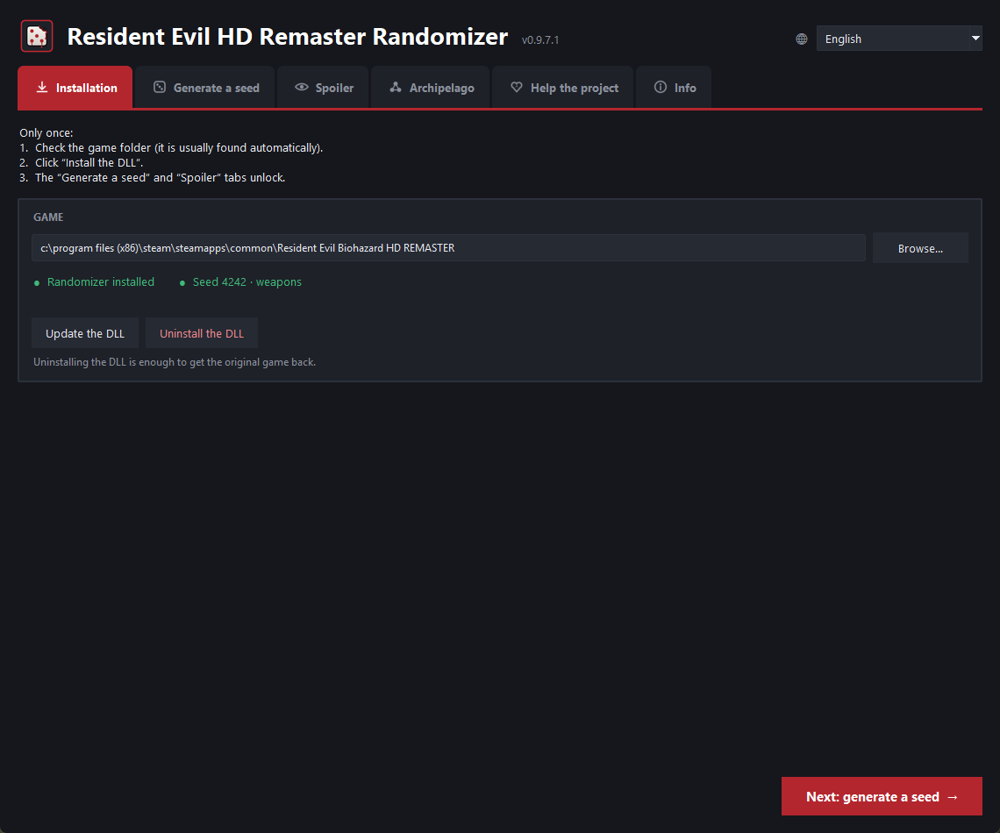
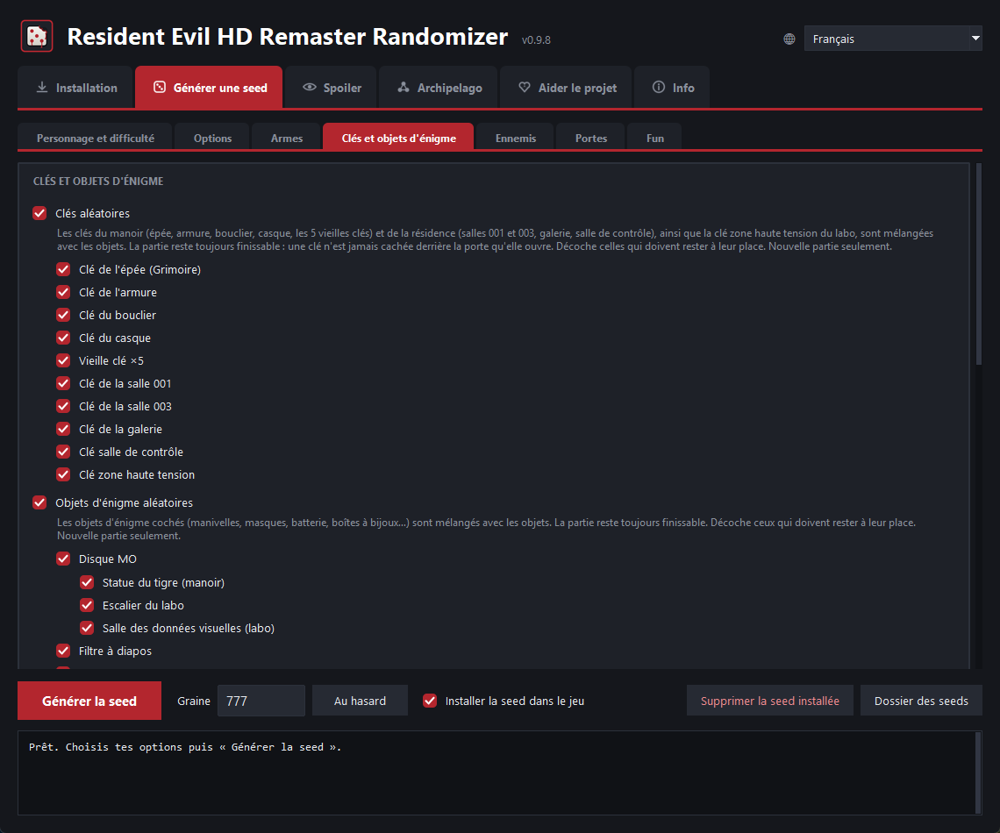
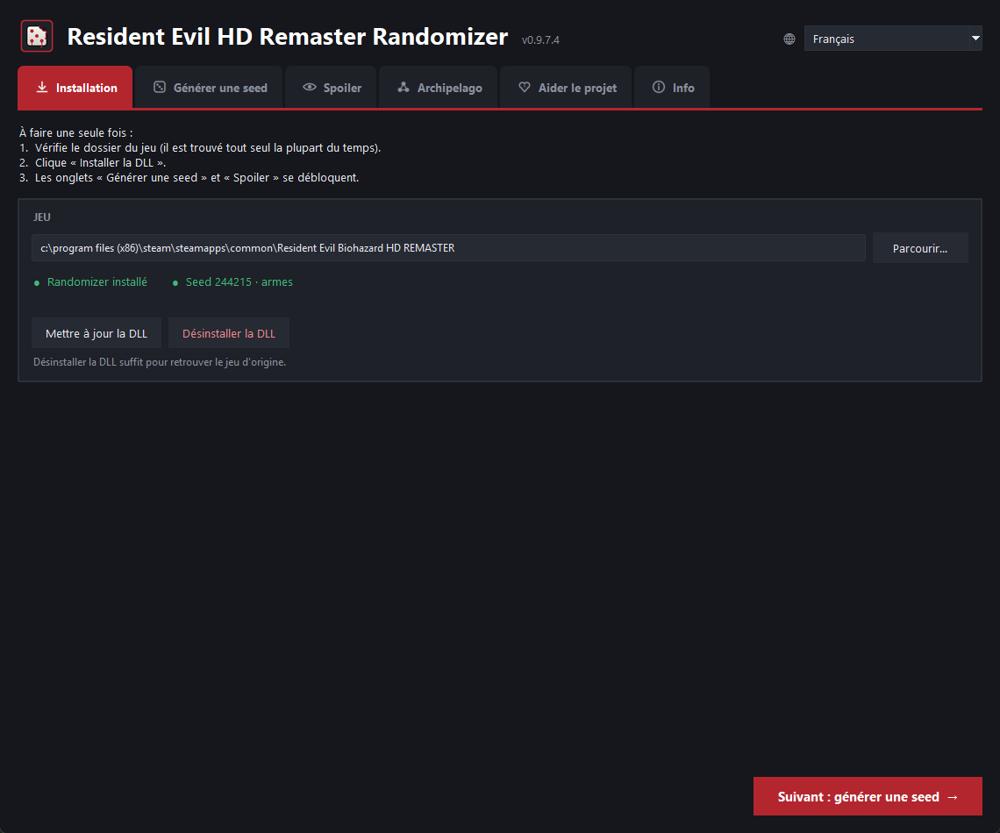
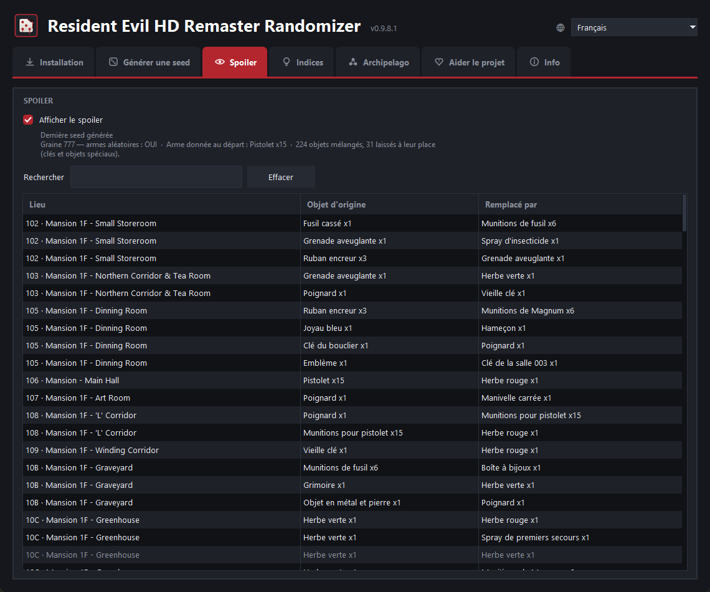
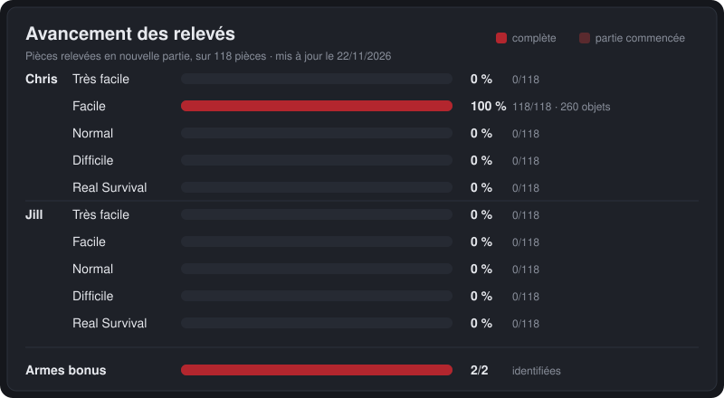

# Resident Evil HD Remaster Randomizer (PC / Steam)

🌐 **English** · [Français](#français) · [Deutsch](README.de.md) · [Español](README.es.md) · [Italiano](README.it.md) · [Português](README.pt.md) · [Русский](README.ru.md) · [日本語](README.ja.md) · [中文](README.zh.md)

**[⬇ Download the latest version](https://github.com/Michiy0/Resident-Evil-HD-Remaster-Randomizer/releases)** ·
[Report a problem](https://github.com/Michiy0/Resident-Evil-HD-Remaster-Randomizer/issues)

The randomizer **moves the game's items around**: ammo, herbs, ink ribbons… are no longer where you
expect them, and every new game plays differently. The new item shows up directly on the floor and in the
preview before pickup.

Each shuffle has a number, the **seed**. The same seed always gives exactly the same shuffle: share the
number and a friend can play the same game as you, each on their own PC or Steam Deck, to compare times
or strategies.

> Unofficial **fan project**, not affiliated with Capcom. No game files are included: you need to own
> [Resident Evil HD Remaster on Steam](https://store.steampowered.com/app/304240/).

## In short

- **Items change places**: ammo, herbs, ink ribbons, daggers… Keys and quest items stay where they are,
  so the game is always completable.
- **A simple app**: install the randomizer, choose your options, generate a seed, and you're ready. One
  click brings back the original game.
- **Nothing else to install**: a small DLL loads with the game and does the work. The game's code is never
  modified.
- **Windows and Steam Deck**: a Windows app, and a native Linux app for the Steam Deck.
- **9 languages**: English, French, German, Italian, Japanese, Spanish, Portuguese, Russian and Chinese (system language
  by default).
- **Community project**: every player can help survey the game's items with the built-in survey mode.
- **Archipelago support coming**: the randomizer is being prepared for [Archipelago](https://archipelago.gg),
  the multi-game randomizer (see [Archipelago](#archipelago-coming-soon)).

## Screenshots

<p align="center"><br><sub>Same room, original game then randomizer: the dagger on the table is now a green herb, and the shotgun hanging on the wall is replaced by a handgun magazine — visible right away, no need to pick them up</sub></p>

<table>
<tr>
<td align="center"><br><sub>Generate a seed: options and weapon choice</sub></td>
<td align="center"><br><sub>Installation: the DLL in one click</sub></td>
</tr>
<tr>
<td align="center" colspan="2"><br><sub>Spoiler: the full list of changes</sub></td>
</tr>
</table>

## Status: version 0.9.6.1 (test)

| Supported | Coming |
|---|---|
| Chris, Normal difficulty (whole game surveyed, laboratory included) | Jill, other difficulties |
| 164 placed-item locations: ammo (handgun, shotgun and magnum), green, red and blue herbs, ink ribbons, daggers, flash grenades, self-defense gun, first aid sprays and boxes | Keys and quest items (with logic that keeps the game completable) |
| **Items visible on the ground**: the new item appears in the room and in the preview before pickup; **random starting item box** option | Visible quest items and items obtained by examining something (trophy gems, fish hook…: already supported by the game DLL, name and preview included), with keys |
| **Random weapons** option, with a choice of which weapons to shuffle (handgun, shotgun, assault shotgun, magnum) and a **guaranteed starting weapon** option (given in the inventory at the start, with its ammo); **random starting knife** option (you may start with no weapon!) | The other weapons (grenade launcher, flamethrower), random enemies |
| **Fun** section: **bonus weapons** (unlimited Samurai Edge and rocket launcher, each replacing a random item) | — |
| Windows and **Steam Deck** (tested in game under Proton, SD card included); Linux | **[Archipelago](#archipelago-coming-soon)** support |

**Required game version**: the current Steam `bhd.exe` (9,640,360 bytes, SHA-256
`39B840663E4B1A6835C60CBD176E4EE6C21B9197FC2C2DD733F2A7C36A0B429A`). The app checks it; on any other
version the randomizer stays inactive and the game is untouched.

## Archipelago (coming soon)

[Archipelago](https://archipelago.gg) is a multi-game randomizer: the items of your game can end up in other
players' games (and the other way round), each on their own game, at the same time. Support for Resident Evil
HD Remaster is being prepared.

- **Already in the app**: an *Archipelago* tab with the connection form (server, player name, password,
  DeathLink), greyed out for now, and the list of what is left to do.
- **Still to do**: keys and quest items shuffled with logic (this comes first), reporting each picked-up
  location to the server, receiving other players' items into the inventory, the game's Archipelago "world"
  (`.apworld` file: items, locations, rules) and sending the goal (ending) to the server.

No date yet: the keys-with-logic step has to be finished first.

## Survey progress

Percentage of rooms surveyed in a **new game**, for each character and difficulty (see
[Help the project](#help-the-project)). Updated with every version.

<!-- progression-en:debut -->


<details><summary>Details (text)</summary>

| Character | Difficulty | Complete rooms | Visited (game in progress) | Items surveyed |
|---|---|---|---|---|
| Chris | Very Easy | 0/118 (0%) | 0 | 0 |
| Chris | Easy | 0/118 (0%) | 0 | 0 |
| Chris | Normal | 117/118 (99%) | 1 | 260 |
| Chris | Hard | 0/118 (0%) | 0 | 0 |
| Chris | Real Survival | 0/118 (0%) | 0 | 0 |
| Jill | Very Easy | 0/118 (0%) | 0 | 0 |
| Jill | Easy | 0/118 (0%) | 0 | 0 |
| Jill | Normal | 0/118 (0%) | 0 | 0 |
| Jill | Hard | 0/118 (0%) | 0 | 0 |
| Jill | Real Survival | 0/118 (0%) | 0 | 0 |

Bonus weapons: 2/2 identified. Updated 2026-11-21.

</details>

<!-- progression-en:fin -->

## Installing

### Windows

1. Download `ResidentEvilHDRemasterRandomizer-v…-windows.zip` from the
   **[Releases](https://github.com/Michiy0/Resident-Evil-HD-Remaster-Randomizer/releases)** and extract it anywhere.
2. Run `Resident Evil HD Remaster Randomizer.exe`. The game folder is found automatically (otherwise: **Browse…**).
3. **Installation** tab: click **Install the DLL** (once). The **Generate a seed** tab unlocks.
4. Choose your options, then **Generate seed** (keep “Install the seed in the game” ticked).
5. Start the game from Steam: **new game, Chris, Normal**.

To change seeds: generate a new one, then restart the game.

**Updates**: the app updates itself automatically since **v0.7**.

> **SmartScreen / antivirus**: the exe is not signed (hobby project). Windows may show “Windows protected
> your PC” → *More info* → *Run anyway*. Some antivirus tools may also flag the DLL by mistake: it uses a
> hardware breakpoint (like Cheat Engine) to detect the item being picked up. The full source code is in
> this repository.

### Steam Deck / Linux

The app has a **native Linux** version (no Proton needed for it); the game itself still runs with Proton.

1. In **Desktop Mode**, download `ResidentEvilHDRemasterRandomizer-v…-linux.tar.gz` and extract it.
2. Double-click `Resident Evil HD Remaster Randomizer` (if needed: right-click → *Properties* → *Permissions* → “Is
   executable”). The game is found in your Steam library, SD card included.
3. **Installation** tab: click **Install the DLL**, then **Copy** the launch option, and paste it once
   in Steam (*game Properties → Launch Options*):
   ```
   WINEDLLOVERRIDES="xinput1_4=n,b" %command%
   ```
   If you use **BhdTool** (or another mod in `dinput8.dll`), tick *Also load dinput8.dll* (ticked
   automatically when it is found): the line becomes `WINEDLLOVERRIDES="xinput1_4=n,b;dinput8=n,b" %command%`.
4. **Generate seed**, then start the game.

The app can also be added to Steam as a **non-Steam game** to use it in **Game Mode**: the **Quit** button, at the top right, closes it cleanly.

> **Tested and confirmed on Steam Deck**: the DLL works in game under Proton (game installed on the SD
> card). If something goes wrong, the **Game log** button shows what happened.

**Back to the original game**: in the app, **Uninstall the DLL** (on Steam Deck, also remove the launch
option). “Remove the installed seed” only removes the seed: without a seed, the DLL changes nothing.

## Usage

The app has six tabs, and a language selector at the top right (“Automatic” = system language, English
otherwise).

- **Installation** — game folder, randomizer and installed seed status, install / update / uninstall the
  DLL (and the launch option on Steam Deck). The app opens here until the DLL is installed and up to date.
- **Generate a seed** — unlocked once the DLL is in place, with four sub-tabs:
  - *Character and difficulty*;
  - *Options*: items visible on the ground (ticked by default; unticked, you see the original item until
    pickup), random starting item box (ticked by default; new game only), random weapons (ticking it shows the weapon list; untick those that should stay in place) and
    guaranteed starting weapon (given in the inventory, with its ammo; its location gets a random item instead) and random
    starting knife (the knife ends up elsewhere: without a guaranteed weapon, you may start with no weapon); below,
    in its own card, *For the crazy ones* (no logic, coming soon);
  - *Enemies*: random enemies (coming soon);
  - *Fun*: bonus weapons (choose the Samurai Edge, the rocket launcher or both);
  - **Generate seed**, with the seed (or “Random”) next to it — same seed + same options = same result: writes
    the seed to the `seeds` folder and installs it in the game.
- **Spoiler** — unlocked as soon as there is a seed: the full list of changes as a table (location, original
  item, replacement), with search and sorting, hidden until you tick *Show spoiler*.
- **Archipelago** — coming soon: the connection form (greyed out) and what is left to do.
- **Help the project** — survey mode and the progress bars (see below).
- **Info** — the credits (author, testers, thanks) and a link to this page.

Options marked “coming soon” (keys, enemies, other weapons, Archipelago…) are visible but greyed out.

### Compatibility

- **BhdTool**: compatible (it uses `dinput8.dll`, the randomizer uses `xinput1_4.dll`).
- **Another mod that installs an `xinput1_4.dll`**: incompatible. The app detects it and never touches it.
- **Cheat Engine**: do not run `appliquer_seed.lua` at the same time (same breakpoint).

## Recommended mods

Optional mods that make the game nicer to play with the randomizer. None of them is required.

### Resident Evil Fusion Fix

[Resident Evil Fusion Fix](https://github.com/ThirteenAG/WidescreenFixesPack/releases/tag/re1) (ThirteenAG)
makes the game more comfortable: every resolution your screen supports, borderless window, door animation
skip, unlocked frame rate (optional), noise filter and color correction can be turned off.
Install: extract `ResidentEvil.FusionFix.zip` into the game folder (settings in
`scripts/ResidentEvil.FusionFix.ini`).

- It works alongside the randomizer (they use different DLLs).
- It uses `dinput8.dll`, **like BhdTool**: you can't have both at once. Fusion Fix is recommended for
  **playing**; for **surveys**, BhdTool is more convenient (see *Help the project*).
- On Steam Deck, also tick *Add dinput8.dll* under the app's launch option.

## Help the project

The randomizer only shuffles items that have already been **surveyed**. Anyone can help by playing:

1. **Help the project** tab → tick **Survey mode** (DLL installed).
2. Start a **new game**: items already picked up no longer exist in memory.
3. Visit rooms without picking anything up; stay about 2 seconds in each. The DLL records the items in
   the game log (small stutter of about 0.3 s when entering a room).
4. Open the log (**Game log** button) and attach it to an
   [issue](https://github.com/Michiy0/Resident-Evil-HD-Remaster-Randomizer/issues), stating your character and difficulty.

**Tip: [BhdTool](https://github.com/eleval/BhdTool) saves a lot of time.** This tool by eleval, made for speedrun practice, is
installed by copying its `dinput8.dll` (and `rooms.json`) into the game folder; it works alongside the
randomizer. In game, **F5** opens its menu:
- its tool to **jump to any room** lets you go around the mansion in a few minutes in survey mode (still
  stay about 2 seconds in each room);
- **Door Skip** removes the door-opening animations.

On Steam Deck, also tick *Also load dinput8.dll* under the app's launch option.

Translations were made for the project: if you speak one of the 9 languages and spot a mistake, please
report it too (texts are in `Randomizer/textes.py`).

## Reporting a problem

Open an [issue](https://github.com/Michiy0/Resident-Evil-HD-Remaster-Randomizer/issues) and attach `randomizer_journal.txt`
(**Game log** button), with the seed, options, platform (Windows or Steam Deck) and what happened.

## For developers

### How it works

- **The app** (`Randomizer/application.py`, Python + Tk) builds a seed from the spreadsheet
  `donnees_randomizer_RE1.xlsx` (locations surveyed in game) and writes it to the game folder as
  `randomizer_seed.lua`. All the logic is in `generateur_seed.py`, also usable from the command line.
- **The DLL** (`DLL/randomizer.c`) poses as `xinput1_4.dll` and forwards every controller function to the
  real Windows DLL. It sets a **hardware breakpoint** on `bhd.exe+1512ED` (where the picked-up item is
  read) and, if the location is in the seed, replaces the item id and quantity. A location is identified
  by its room and its **fingerprint**: the 4 corners (x, z) of its pick-up area, identical on every PC.
- **Survey mode** (`Releve=1` in `randomizer.ini`) finds the placed items in memory when entering each
  room, using their signature (`00C233F4` / `00C2286C`), without picking anything up.
- `bhd.exe` is protected by SteamStub (code encrypted on disk): the DLL never modifies the code and goes
  idle on any other game version.

### Repository contents

```
donnees_randomizer_RE1.xlsx   data: rooms, items, locations, surveyed rooms, bonus
DLL/                          the DLL (randomizer.c, xinput1_4.def) and its build scripts
Randomizer/
  application.py              the app (6 tabs, 9 languages)
  mise_a_jour.py              automatic update from the GitHub Releases
  noms_jeu.py                 official item names, read from the installed game's texts
  generateur_seed.py          seed generation (also command line)
  importer_journal.py         imports survey logs into the spreadsheet
  progression.py              progress bars of this README
  textes.py                   all translations
  construire_exe.bat / construire_linux.sh, creer_icone.py, icons
outils/cheat_engine/          older Cheat Engine scripts (manual surveys)
preparer_publication.py       prepares the repository, the Windows zip and the Linux archive
```

### Building

- **Windows** — Python 3 (`pip install openpyxl pyinstaller`) and 32-bit GCC from MSYS2
  (`pacman -S mingw-w64-i686-gcc`):
  ```bat
  DLL\compiler.bat
  Randomizer\construire_exe.bat
  ```
- **Linux** (or WSL; Ubuntu 22.04 recommended to stay compatible with the Steam Deck) —
  `sudo apt install python3 python3-venv python3-tk gcc-mingw-w64-i686`:
  ```sh
  sh DLL/compiler.sh
  sh Randomizer/construire_linux.sh
  ```
- **Without building**: `python Randomizer/application.py`, or from the command line
  `python Randomizer/generateur_seed.py 12345 --armes-aleatoires --installer`.
- **Importing surveys**:
  `python Randomizer/importer_journal.py journal.txt --personnage Chris --difficulte Normal --nouvelle-partie --ecrire`
  (without `--nouvelle-partie` if the game was already in progress: rooms then only count as visited).

The code, file names and command-line options are in French (the project's working language).

## Credits

- **Author**: **Jojo / Michiyo** (Delage Jordan) — [GitHub profile](https://github.com/Michiy0).
- **Testing and item surveys**: **Nico** (De Oliveira Gomes Nicolas) — “Number One Chris Fan” 👊
- **[BhdTool](https://github.com/eleval/BhdTool)** (eleval, GPLv3): its `rooms.json` provides the room names and connections, and
  the tool is a great help for surveys (see [Help the project](#help-the-project)).
- Inspired by community randomizers (BioRand, Benn Powell's former randomizer).

## License

GPLv3 — see [LICENSE](LICENSE).

---

# Français

🌐 [English](#resident-evil-hd-remaster-randomizer-pc--steam) · **Français** · [Deutsch](README.de.md) · [Español](README.es.md) · [Italiano](README.it.md) · [Português](README.pt.md) · [Русский](README.ru.md) · [日本語](README.ja.md) · [中文](README.zh.md)

**[⬇ Télécharger la dernière version](https://github.com/Michiy0/Resident-Evil-HD-Remaster-Randomizer/releases)** ·
[Signaler un problème](https://github.com/Michiy0/Resident-Evil-HD-Remaster-Randomizer/issues)

Le randomizer **change la place des objets** du jeu : munitions, herbes, rubans encreurs… ne sont plus là
où tu les attends, et chaque nouvelle partie se joue différemment.

Chaque mélange porte un numéro, la **graine** (ou *seed*). La même graine donne toujours exactement le
même mélange : en partageant ce numéro, un ami peut jouer la même partie que toi, chacun de son côté
(sur son PC ou son Steam Deck), pour comparer vos temps ou vos stratégies.

> Projet de fan, **non officiel**, sans lien avec Capcom. Aucun fichier du jeu n'est inclus : il faut
> posséder [Resident Evil HD Remaster sur Steam](https://store.steampowered.com/app/304240/).

## En bref

- **Les objets changent de place** : munitions, herbes, rubans encreurs, poignards… Les clés et objets de
  quête restent à leur place, la partie reste toujours finissable.
- **On voit le nouvel objet** : il apparaît directement par terre dans le décor et dans l'aperçu avant
  ramassage (option « Objets visibles par terre »).
- **Une application simple** : on installe le randomizer, on choisit ses options, on génère une seed, et
  c'est prêt. Un clic suffit pour revenir au jeu d'origine.
- **Rien d'autre à installer** : une petite DLL se charge avec le jeu et fait le travail. Le code du jeu n'est
  jamais modifié.
- **Windows et Steam Deck** : application Windows, et application Linux native pour le Steam Deck.
- **9 langues** : français, anglais, allemand, italien, japonais, espagnol, portugais, russe et chinois (langue du système
  par défaut).
- **Projet communautaire** : chaque joueur peut aider à relever les objets du jeu, grâce à un mode relevé
  intégré.
- **Support d'Archipelago à venir** : le randomizer se prépare pour [Archipelago](https://archipelago.gg),
  le randomizer multi-jeux (voir [Archipelago](#archipelago-à-venir)).

## Aperçu

<p align="center"><br><sub>La même pièce, jeu d'origine puis randomizer : le poignard sur la table est devenu une herbe verte, et le fusil à pompe accroché au mur est remplacé par un chargeur de pistolet — visibles tout de suite, sans avoir à les ramasser</sub></p>

<table>
<tr>
<td align="center"><br><sub>Générer une seed : options et choix des armes</sub></td>
<td align="center"><br><sub>Installation : la DLL en un clic</sub></td>
</tr>
<tr>
<td align="center" colspan="2"><br><sub>Spoiler : la liste complète des changements</sub></td>
</tr>
</table>

## État : version 0.9.6.1 (test)

| Pris en charge | À venir |
|---|---|
| Chris, difficulté Normal (tout le jeu relevé, laboratoire compris) | Jill, autres difficultés |
| 164 emplacements d'objets posés : munitions (pistolet, fusil et Magnum), herbes vertes, rouges et bleues, rubans encreurs, poignards, grenades aveuglantes, pistolet d'autodéfense, sprays et trousses de premiers secours | Clés et objets de quête (avec une logique qui garantit que la partie reste finissable) |
| **Objets visibles par terre** : le nouvel objet s'affiche dans le décor et dans l'aperçu avant ramassage ; option **malle de départ aléatoire** | Objets de quête visibles et objets obtenus en examinant quelque chose (joyaux des trophées, hameçon… : déjà gérés par la DLL du jeu, nom et aperçu compris), avec les clés |
| Option **armes aléatoires**, avec le choix des armes à mélanger (pistolet, fusil, fusil d'assaut, Magnum) et option **arme garantie au départ** (donnée dans l'inventaire au début, avec ses munitions) ; option **couteau de départ aléatoire** (on peut commencer sans arme !) | Les autres armes (lance-grenades, lance-flammes), ennemis aléatoires |
| Section **Fun** : **armes bonus** (Samurai Edge et lance-roquettes illimités, chacun à la place d'un objet au hasard) | — |
| Windows et **Steam Deck** (testé en jeu sous Proton, carte SD comprise) ; Linux | Support d'**[Archipelago](#archipelago-à-venir)** |

**Version du jeu requise** : la version Steam actuelle de `bhd.exe` (9 640 360 octets, SHA-256
`39B840663E4B1A6835C60CBD176E4EE6C21B9197FC2C2DD733F2A7C36A0B429A`). L'application le vérifie ; sur une
autre version, le randomizer se met en veille et le jeu reste intact.

## Archipelago (à venir)

[Archipelago](https://archipelago.gg) est un randomizer multi-jeux : les objets de ta partie peuvent se
retrouver dans le jeu d'autres joueurs (et inversement), chacun sur son propre jeu, en même temps. Le support
de Resident Evil HD Remaster est en préparation.

- **Déjà dans l'application** : un onglet *Archipelago* avec le formulaire de connexion (serveur, nom du
  joueur, mot de passe, DeathLink), grisé pour l'instant, et la liste de ce qu'il reste à faire.
- **Reste à faire** : le mélange des clés et objets de quête avec la logique (en premier), l'envoi au serveur
  de chaque emplacement ramassé, la réception dans l'inventaire des objets des autres joueurs, le « monde »
  Archipelago du jeu (fichier `.apworld` : objets, emplacements, règles) et l'envoi de l'objectif (fin du jeu)
  au serveur.

Pas encore de date : le mélange des clés avec la logique doit être terminé avant.

## Avancement des relevés

Pourcentage de pièces relevées en **nouvelle partie** pour chaque personnage et difficulté
(voir [Aider le projet](#aider-le-projet)). Mis à jour à chaque version.

<!-- progression:debut -->



<details><summary>Détail (texte)</summary>

| Personnage | Difficulté | Pièces complètes | Visitées (partie commencée) | Objets relevés |
|---|---|---|---|---|
| Chris | Très facile | 0/118 (0 %) | 0 | 0 |
| Chris | Facile | 0/118 (0 %) | 0 | 0 |
| Chris | Normal | 117/118 (99 %) | 1 | 260 |
| Chris | Difficile | 0/118 (0 %) | 0 | 0 |
| Chris | Real Survival | 0/118 (0 %) | 0 | 0 |
| Jill | Très facile | 0/118 (0 %) | 0 | 0 |
| Jill | Facile | 0/118 (0 %) | 0 | 0 |
| Jill | Normal | 0/118 (0 %) | 0 | 0 |
| Jill | Difficile | 0/118 (0 %) | 0 | 0 |
| Jill | Real Survival | 0/118 (0 %) | 0 | 0 |

Armes bonus : 2/2 identifiées. Mis à jour le 21/11/2026.

</details>

<!-- progression:fin -->

## Installation

### Windows

1. Télécharge `ResidentEvilHDRemasterRandomizer-v…-windows.zip` dans les **[Releases](https://github.com/Michiy0/Resident-Evil-HD-Remaster-Randomizer/releases)**
   et extrais-le où tu veux.
2. Lance `Resident Evil HD Remaster Randomizer.exe`. Le dossier du jeu est trouvé automatiquement (sinon : **Parcourir…**).
3. Onglet **Installation** : clique **Installer la DLL** (une seule fois). L'onglet **Générer une seed**
   se débloque.
4. Choisis tes options, puis **Générer la seed** (laisse cochée « Installer la seed dans le jeu »).
5. Lance le jeu depuis Steam : **nouvelle partie, Chris, Normal**.

Pour changer de seed : en générer une nouvelle, puis relancer le jeu.

### Mises à jour

L'application se met à jour automatiquement depuis la **v0.7**.

> **SmartScreen / antivirus** : l'exe n'est pas signé (projet amateur). Windows peut afficher « Windows a
> protégé votre ordinateur » → *Informations complémentaires* → *Exécuter quand même*. Certains antivirus
> peuvent aussi signaler la DLL par erreur : elle utilise un point d'arrêt matériel (comme Cheat Engine)
> pour repérer l'objet ramassé. Tout le code source est dans ce dépôt.

### Steam Deck / Linux

L'application existe en version **Linux native** (pas besoin de Proton pour elle) ; le jeu, lui, tourne
toujours avec Proton.

1. En **mode Bureau**, télécharge `ResidentEvilHDRemasterRandomizer-v…-linux.tar.gz` et extrais-le.
2. Double-clique sur `Resident Evil HD Remaster Randomizer` (si besoin : clic droit → *Propriétés* → *Permissions* →
   « Est exécutable »). Le jeu est trouvé dans la bibliothèque Steam, carte SD comprise.
3. Onglet **Installation** : clique **Installer la DLL**, puis **Copier** l'option de lancement, et
   colle-la une fois dans Steam (*Propriétés du jeu → Options de lancement*) :
   ```
   WINEDLLOVERRIDES="xinput1_4=n,b" %command%
   ```
   Si tu utilises **BhdTool** (ou un autre mod en `dinput8.dll`), coche *Ajouter dinput8.dll* (cochée d'office
   s'il est détecté) : la ligne devient `WINEDLLOVERRIDES="xinput1_4=n,b;dinput8=n,b" %command%`.
4. **Générer la seed**, puis lance le jeu.

L'application peut aussi être ajoutée à Steam comme **jeu non-Steam** pour l'utiliser en **mode Jeu** : le bouton **Quitter**, en haut à droite, la ferme proprement.

> **Testé et confirmé sur Steam Deck** : la DLL fonctionne dans le jeu sous Proton (jeu installé sur la
> carte SD). En cas de souci, le bouton **Journal du jeu** montre ce qui s'est passé.

### Revenir au jeu d'origine

Dans l'application : **Désinstaller la DLL** (sur Steam Deck, retire aussi l'option de lancement).
« Supprimer la seed installée » retire seulement la seed : sans seed, la DLL ne change rien au jeu.

## Utilisation

L'application a six onglets, et un sélecteur de langue en haut à droite (« Automatique » = langue du
système, anglais sinon).

- **Installation** — dossier du jeu, état du randomizer et de la seed installée, installer / mettre à
  jour / désinstaller la DLL (et l'option de lancement sur Steam Deck). L'application s'ouvre ici tant
  que la DLL n'est pas installée et à jour.
- **Générer une seed** — débloqué une fois la DLL en place, avec quatre sous-onglets :
  - *Personnage et difficulté* ;
  - *Options* : objets visibles par terre (cochée d'office ; décochée, on voit l'objet d'origine jusqu'au
    ramassage), malle de départ aléatoire (cochée d'office ; nouvelle partie seulement), armes aléatoires (cocher la case affiche la liste des armes ; décoche celles qui doivent
    rester à leur place), arme garantie au départ (donnée dans l'inventaire, avec ses munitions ; son emplacement
    reçoit un objet au hasard) et couteau de départ aléatoire (le couteau se retrouve ailleurs : sans arme garantie,
    on peut commencer sans arme) ; en dessous, dans sa propre carte, *Pour les fous* (sans logique, à venir) ;
  - *Ennemis* : ennemis aléatoires (à venir) ;
  - *Fun* : armes bonus (au choix le Samurai Edge, le lance-roquettes ou les deux) ;
  - **Générer la seed**, avec la graine (ou « Au hasard ») juste à côté — même graine + mêmes options = même
    résultat : écrit la seed dans le dossier `seeds` et l'installe dans le jeu.
- **Spoiler** — débloqué dès qu'il y a une seed : la liste complète des changements en tableau (lieu, objet
  d'origine, objet qui le remplace), avec recherche et tri, cachée tant qu'on ne coche pas *Afficher le
  spoiler*.
- **Archipelago** — à venir : le formulaire de connexion (grisé) et ce qu'il reste à faire.
- **Aider le projet** — le mode relevé et les barres d'avancement (voir plus bas).
- **Info** — les crédits (auteur, testeurs, remerciements) et le lien vers cette page.

Les options marquées « à venir » (clés, ennemis, autres armes, Archipelago…) sont visibles mais grisées.

### Compatibilité

- **BhdTool** : compatible (il utilise `dinput8.dll`, le randomizer `xinput1_4.dll`).
- **Autre mod qui installe un `xinput1_4.dll`** : incompatible. L'application le détecte et n'y touche
  jamais.
- **Cheat Engine** : ne pas lancer `appliquer_seed.lua` en même temps (même point d'arrêt).

## Mods recommandés

Des mods facultatifs qui rendent le jeu plus agréable avec le randomizer. Aucun n'est obligatoire.

### Resident Evil Fusion Fix

[Resident Evil Fusion Fix](https://github.com/ThirteenAG/WidescreenFixesPack/releases/tag/re1) (ThirteenAG)
améliore le confort de jeu : toutes les résolutions de l'écran, fenêtre sans bordure, saut des animations de
porte, images par seconde débloquées (option), filtre de bruit et correction des couleurs désactivables.
Installation : extraire l'archive `ResidentEvil.FusionFix.zip` dans le dossier du jeu (réglages dans
`scripts/ResidentEvil.FusionFix.ini`).

- Il fonctionne à côté du randomizer (ce ne sont pas les mêmes DLL).
- Il utilise `dinput8.dll`, **comme BhdTool** : on ne peut pas avoir les deux en même temps. Fusion Fix est
  donc conseillé pour **jouer** ; pour **les relevés**, BhdTool reste plus pratique (voir *Aider le projet*).
- Sur Steam Deck, coche *Ajouter dinput8.dll* sous l'option de lancement de l'application.

## Aider le projet

Le randomizer ne mélange que les objets déjà **relevés**. Tout le monde peut aider en jouant :

1. Onglet **Aider le projet** → coche **Mode relevé** (DLL installée).
2. Lance une **nouvelle partie** : les objets déjà ramassés n'existent plus en mémoire.
3. Visite les pièces sans rien ramasser ; reste environ 2 secondes dans chacune. La DLL note les objets
   présents dans le journal du jeu (petite saccade d'environ 0,3 s à l'entrée d'une pièce).
4. Ouvre le journal (bouton **Journal du jeu**) et joins-le à une
   [issue](https://github.com/Michiy0/Resident-Evil-HD-Remaster-Randomizer/issues), en précisant le personnage et la difficulté.

**Astuce : [BhdTool](https://github.com/eleval/BhdTool) fait gagner beaucoup de temps.** Cet outil d'eleval, fait pour l'entraînement
au speedrun, s'installe en copiant son `dinput8.dll` (et `rooms.json`) dans le dossier du jeu ; il est
compatible avec le randomizer. En jeu, **F5** ouvre son menu :
- son outil pour **aller directement dans n'importe quelle pièce** permet de faire le tour du manoir en
  quelques minutes, en mode relevé (reste toujours environ 2 secondes dans chaque pièce) ;
- le **saut des portes** (*Door Skip*) supprime les animations d'ouverture de porte.

Sur Steam Deck, coche aussi *Ajouter dinput8.dll* sous l'option de lancement de l'application.

Les traductions ont été faites pour le projet : si tu parles une des 9 langues et vois une erreur,
signale-la aussi (les textes sont dans `Randomizer/textes.py`).

## Signaler un problème

Ouvre une [issue](https://github.com/Michiy0/Resident-Evil-HD-Remaster-Randomizer/issues) en joignant `randomizer_journal.txt`
(bouton **Journal du jeu**), avec la graine, les options, ta plateforme (Windows ou Steam Deck) et ce qui
s'est passé.

---

## Pour les développeurs

### Comment ça marche

- **L'application** (`Randomizer/application.py`, Python + Tk) tire une seed à partir du tableur
  `donnees_randomizer_RE1.xlsx` (emplacements relevés en jeu) et l'écrit dans le dossier du jeu sous le
  nom `randomizer_seed.lua`. Toute la logique est dans `generateur_seed.py`, utilisable aussi en ligne de
  commande.
- **La DLL** (`DLL/randomizer.c`) se fait passer pour `xinput1_4.dll` et transmet toutes les fonctions
  manette à la vraie DLL de Windows. Elle pose un **point d'arrêt matériel** sur `bhd.exe+1512ED` (lecture
  de l'objet ramassé) et, si l'emplacement est dans la seed, remplace l'identifiant et la quantité. Un
  emplacement est reconnu par sa pièce et son **empreinte** : les 4 coins (x, z) de sa zone de ramassage,
  identiques sur tous les PC.
- **Le mode relevé** (`Releve=1` dans `randomizer.ini`) repère à l'entrée de chaque pièce les objets posés
  en mémoire grâce à leur signature (`00C233F4` / `00C2286C`), sans rien ramasser.
- `bhd.exe` est protégé par SteamStub (code chiffré sur le disque) : la DLL ne modifie jamais le code et
  se met en veille sur une autre version du jeu.

### Contenu du dépôt

```
donnees_randomizer_RE1.xlsx   données : pièces, objets, emplacements, pièces relevées, bonus
DLL/                          la DLL (randomizer.c, xinput1_4.def) et ses scripts de compilation
Randomizer/
  application.py              l'application (6 onglets, 9 langues)
  mise_a_jour.py              mise à jour automatique depuis les Releases GitHub
  noms_jeu.py                 noms officiels des objets, lus dans les textes du jeu installé
  generateur_seed.py          génération des seeds (aussi en ligne de commande)
  importer_journal.py         importe les journaux de relevés dans le tableur
  progression.py              barres d'avancement de ce README
  textes.py                   toutes les traductions
  construire_exe.bat / construire_linux.sh, creer_icone.py, icônes
outils/cheat_engine/          anciens scripts Cheat Engine (relevés manuels)
preparer_publication.py       prépare le dépôt, le zip Windows et l'archive Linux
```

### Construire

- **Windows** — Python 3 (`pip install openpyxl pyinstaller`) et GCC 32 bits de MSYS2
  (`pacman -S mingw-w64-i686-gcc`) :
  ```bat
  DLL\compiler.bat
  Randomizer\construire_exe.bat
  ```
- **Linux** (ou WSL ; Ubuntu 22.04 conseillé pour rester compatible avec le Steam Deck) —
  `sudo apt install python3 python3-venv python3-tk gcc-mingw-w64-i686` :
  ```sh
  sh DLL/compiler.sh
  sh Randomizer/construire_linux.sh
  ```
- **Sans compiler** : `python Randomizer/application.py`, ou en ligne de commande
  `python Randomizer/generateur_seed.py 12345 --armes-aleatoires --installer`.
- **Importer des relevés** :
  `python Randomizer/importer_journal.py journal.txt --personnage Chris --difficulte Normal --nouvelle-partie --ecrire`
  (sans `--nouvelle-partie` si la partie était déjà commencée : les pièces comptent alors comme visitées).

## Crédits

- **Auteur** : **Jojo / Michiyo** (Delage Jordan) — [profil GitHub](https://github.com/Michiy0).
- **Tests et relevés des objets** : **Nico** (De Oliveira Gomes Nicolas) — « Number One Chris Fan » 👊
- **[BhdTool](https://github.com/eleval/BhdTool)** (eleval, GPLv3) : son `rooms.json` fournit les noms et liaisons des pièces, et
  l'outil aide beaucoup pour les relevés (voir [Aider le projet](#aider-le-projet)).
- Inspiré des randomizers de la communauté (BioRand, ancien randomizer de Benn Powell).

## Licence

GPLv3 — voir [LICENSE](LICENSE).
