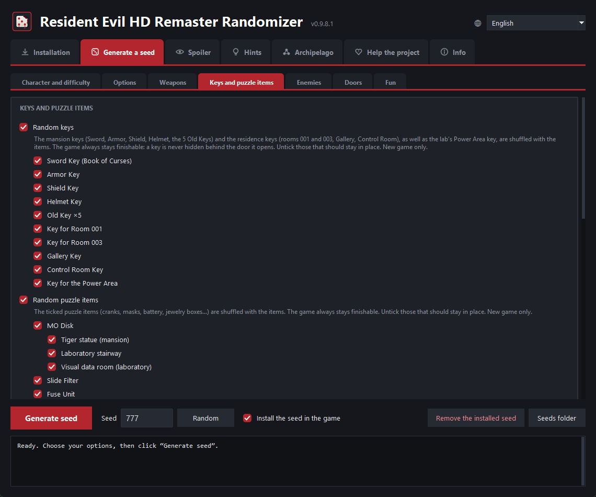
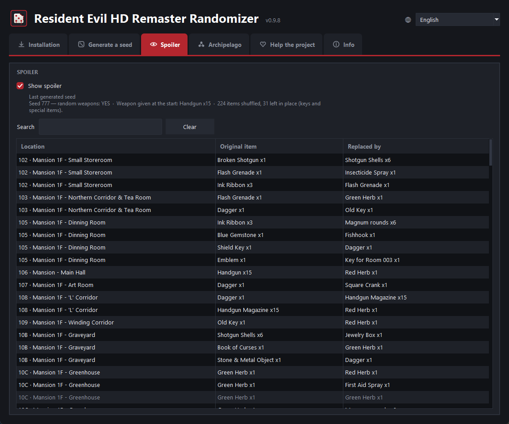

# Resident Evil HD Remaster Randomizer (PC / Steam)

[English](README.en.md) · [Français](README.fr.md) · [Deutsch](README.de.md) · [Español](README.es.md) · [Italiano](README.it.md) · [Português](README.pt.md) · [Русский](README.ru.md) · [日本語](README.ja.md) · **中文**

> ⚠️ **本翻译尚未经过母语人士校对。** 英文版（[README.md](README.md)）为准，内容可能更新。如发现错误，请在
> [issue](https://github.com/Michiy0/Resident-Evil-HD-Remaster-Randomizer/issues) 中告诉我们。

**[⬇ 下载最新版本](https://github.com/Michiy0/Resident-Evil-HD-Remaster-Randomizer/releases)** ·
[报告问题](https://github.com/Michiy0/Resident-Evil-HD-Remaster-Randomizer/issues)

这个随机器会**打乱游戏中物品的位置**：弹药、草药、色带……不再出现在你熟悉的地方，每次新游戏都不一样。新的物品会
直接出现在地上，拾取前的预览中也能看到。

每次打乱都有一个编号，即**种子**。同一个种子总是得到完全相同的打乱结果：把编号分享给朋友，你们就能在各自的电脑或
Steam Deck 上玩同一局游戏，比较用时或打法。

> 非官方的**粉丝项目**，与 Capcom 无关。不包含任何游戏文件：你需要拥有
> [Steam 版 Resident Evil HD Remaster（生化危机 HD 重制版）](https://store.steampowered.com/app/304240/)。

## 简介

- **物品换位置**：弹药、草药、色带、匕首……钥匙和任务物品保持原位，因此游戏始终可以通关。
- **简单的应用**：安装随机器，选择选项，生成种子，就可以开玩。一键即可恢复原版游戏。
- **无需安装其他东西**：一个小小的 DLL 随游戏加载并完成全部工作。从不修改游戏代码。
- **Windows 和 Steam Deck**：Windows 应用，以及为 Steam Deck 准备的原生 Linux 应用。
- **9 种语言**：英语、法语、德语、意大利语、日语、西班牙语、葡萄牙语、俄语和中文（默认使用系统语言）。
- **社区项目**：每位玩家都可以用内置的记录模式帮助记录游戏中的物品。
- **正在准备支持 Archipelago**：见 [Archipelago](#archipelago即将推出)。

## 截图

<p align="center"><br><sub>同一个房间，先是原版游戏，然后是随机器：桌上的匕首变成了绿色草药，挂在墙上的霰弹枪换成了手枪弹匣——无需拾取，一眼就能看到</sub></p>

<table>
<tr>
<td align="center"><br><sub>生成种子：选项与武器选择</sub></td>
<td align="center"><br><sub>安装：一键安装 DLL</sub></td>
</tr>
<tr>
<td align="center" colspan="2"><br><sub>剧透：完整的变动列表</sub></td>
</tr>
</table>

## 当前状态

| 已支持 | 即将推出 |
|---|---|
| 克里斯，普通难度（已记录整个游戏，包括研究所） | 吉尔，其他难度 |
| 164 个位置：弹药（手枪、霰弹枪和麦格农）、绿色/红色/蓝色药草、色带、匕首、闪光手榴弹、防身手枪、急救喷雾和急救箱 | 钥匙和任务物品（带有保证可以通关的逻辑） |
| **地上可见物品**：新物品会出现在房间和预览中；选项 **随机初始道具箱** | 可见的任务物品和调查时获得的物品（奖杯上的宝石、鱼钩……：DLL 已支持），将与钥匙一起推出 |
| 选项 **随机武器**（手枪、霰弹枪、突击霰弹枪、麦格农）和 **开局保证有武器**（开局时连同弹药放入物品栏）；选项 **随机初始小刀**（可能在没有任何武器的情况下开始！） | 其他武器（榴弹发射器、火焰喷射器）、随机敌人 |
| **娱乐** 部分：**奖励武器**（无限弹药的武士之刃和火箭筒） | — |
| Windows 和 **Steam Deck**（已在 Proton 下实机测试，包括 SD 卡）；Linux | **[Archipelago](#archipelago即将推出)** |

**所需游戏版本**：当前 Steam 版 `bhd.exe`（9,640,360 字节）。应用会检查版本；如果是其他版本，随机器不会启用，游戏保持原样。

## Archipelago（即将推出）

[Archipelago](https://archipelago.gg) 是一个多游戏随机器：你游戏中的物品可能出现在其他玩家的游戏里（反之亦然），
大家各玩各的游戏，同时进行。对 Resident Evil HD Remaster 的支持正在准备中：应用的 *Archipelago* 标签页已经显示了
连接表单（暂不可用）以及剩余的工作。首先需要实现带逻辑的钥匙随机化。

## 记录进度

在**新游戏**中已记录房间的比例，按角色和难度划分（见 [协助项目](#协助项目)）。详情见[英文版](README.md#survey-progress)。


## 安装

### Windows

1. 从 **[Releases](https://github.com/Michiy0/Resident-Evil-HD-Remaster-Randomizer/releases)** 下载
   `ResidentEvilHDRemasterRandomizer-v…-windows.zip`，解压到任意位置。
2. 运行 `Resident Evil HD Remaster Randomizer.exe`。游戏文件夹会被自动找到（否则点击 **浏览…**）。
3. **安装** 标签页：点击 **安装 DLL**（只需一次）。**生成种子** 标签页随即解锁。
4. 选择选项，点击 **生成种子**（保持勾选“将种子安装到游戏”）。
5. 通过 Steam 启动游戏：**新游戏，克里斯，普通**。

更换种子：生成新的种子并重启游戏。应用会**自动更新**。

> **SmartScreen / 杀毒软件**：exe 没有签名（业余项目）。Windows 可能显示“Windows 已保护你的电脑”→ *更多信息* →
> *仍要运行*。部分杀毒软件可能误报 DLL：它使用了硬件断点（与 Cheat Engine 相同）。全部源代码都在本仓库中。

### Steam Deck / Linux

应用提供**原生 Linux 版本**（无需 Proton）；游戏本身仍通过 Proton 运行。

1. 在**桌面模式**下载 `ResidentEvilHDRemasterRandomizer-v…-linux.tar.gz` 并解压。
2. 双击 `Resident Evil HD Remaster Randomizer`（如有需要：右键 → *属性* → *权限* →“可执行”）。游戏会在你的 Steam
   库中被找到，包括 SD 卡。
3. **安装** 标签页：点击 **安装 DLL**，然后 **复制** 启动选项，并在 Steam 中粘贴一次（*游戏属性 → 启动选项*）：
   ```
   WINEDLLOVERRIDES="xinput1_4=n,b" %command%
   ```
   如果你使用 **BhdTool**（或其他使用 `dinput8.dll` 的模组），请勾选 *同时加载 dinput8.dll*。
4. **生成种子**，然后启动游戏。

也可以把应用作为**非 Steam 游戏**添加到 Steam，以便在**游戏模式**中使用：右上角的 **退出** 按钮可以正常关闭它。

**恢复原版游戏**：在应用中点击 **卸载 DLL**（在 Steam Deck 上还需删除启动选项）。

## 使用方法

应用有六个标签页，右上角可以选择语言（“自动”= 系统语言）。

- **安装** — 游戏文件夹、随机器和已安装种子的状态、安装 / 更新 / 卸载 DLL（以及 Steam Deck 上的启动选项）。
- **生成种子** — 包含四个子标签页：
  - *角色与难度*；
  - *选项*：地上可见物品、随机初始道具箱、随机武器（含武器列表）、开局保证有武器（连同弹药放入物品栏；其原位置
    改为一个随机物品）和随机初始小刀；下方是 *疯狂玩家专用*（无逻辑，即将推出）；
  - *敌人*：随机敌人（即将推出）；
  - *娱乐*：奖励武器（武士之刃、火箭筒或两者）；
  - **生成种子**，旁边是种子（或“随机”）——相同种子 + 相同选项 = 相同结果。
- **剧透** — 以表格显示完整的变动列表，可搜索和排序；勾选 *显示剧透* 之前保持隐藏。
- **Archipelago** — 即将推出。
- **协助项目** — 记录模式和进度条。
- **信息** — 致谢和本页面的链接。

### 兼容性

- **BhdTool**：兼容（它使用 `dinput8.dll`，随机器使用 `xinput1_4.dll`）。
- **其他安装 `xinput1_4.dll` 的模组**：不兼容。应用会检测到它，并且绝不会改动它。

## 推荐模组

### Resident Evil Fusion Fix

[Resident Evil Fusion Fix](https://github.com/ThirteenAG/WidescreenFixesPack/releases/tag/re1)（ThirteenAG）让游戏
更舒适：支持所有分辨率、无边框窗口、跳过开门动画、解锁帧率（可选）等。安装：将 `ResidentEvil.FusionFix.zip`
解压到游戏文件夹。

- 可以和随机器一起使用。
- 它和 **BhdTool 一样**使用 `dinput8.dll`：两者不能同时使用。**游玩**用 Fusion Fix，**记录**用 BhdTool。
- 在 Steam Deck 上，还要勾选 *同时加载 dinput8.dll*。

## 协助项目

随机器只会打乱已经**记录过**的物品。任何人都可以通过游玩来帮忙：

1. **协助项目** 标签页 → 勾选 **记录模式**（需已安装 DLL）。
2. 开始一局**新游戏**。
3. 不拾取任何物品地逛各个房间；在每个房间停留约 2 秒。
4. 打开日志（**游戏日志** 按钮），附在一个
   [issue](https://github.com/Michiy0/Resident-Evil-HD-Remaster-Randomizer/issues) 中，并注明角色和难度。

**小提示：[BhdTool](https://github.com/eleval/BhdTool) 能节省大量时间**（直接跳到任意房间、跳过开门动画；用 **F5** 打开菜单）。

## 报告问题

创建一个 [issue](https://github.com/Michiy0/Resident-Evil-HD-Remaster-Randomizer/issues)，附上 `randomizer_journal.txt`
（**游戏日志** 按钮），并写明种子、选项、平台以及发生了什么。

## 开发者

请参阅[英文版](README.md#for-developers)（工作原理、仓库内容、构建方法）。

## 致谢

- **作者**：**Jojo / Michiyo**（Delage Jordan）— [GitHub 主页](https://github.com/Michiy0)
- **测试与物品记录**：**Nico**（De Oliveira Gomes Nicolas）— “Number One Chris Fan” 👊
- **[BhdTool](https://github.com/eleval/BhdTool)**（eleval，GPLv3）：房间名称与连接，对记录工作帮助很大。
- 灵感来自社区随机器（BioRand、Benn Powell 的旧版随机器）。

## 许可证

GPLv3 — 见 [LICENSE](LICENSE)。
