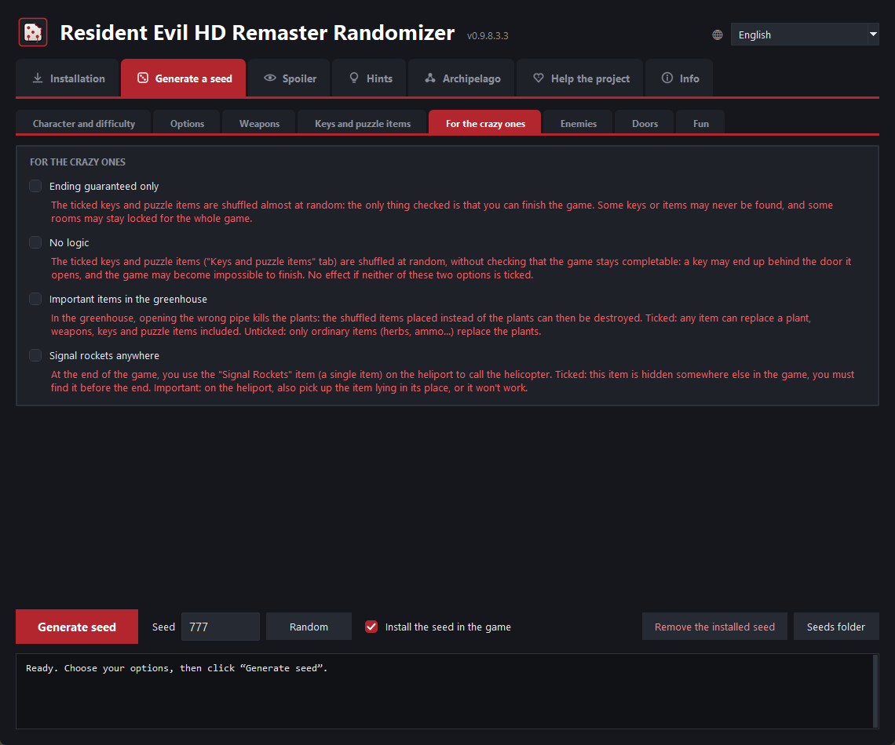
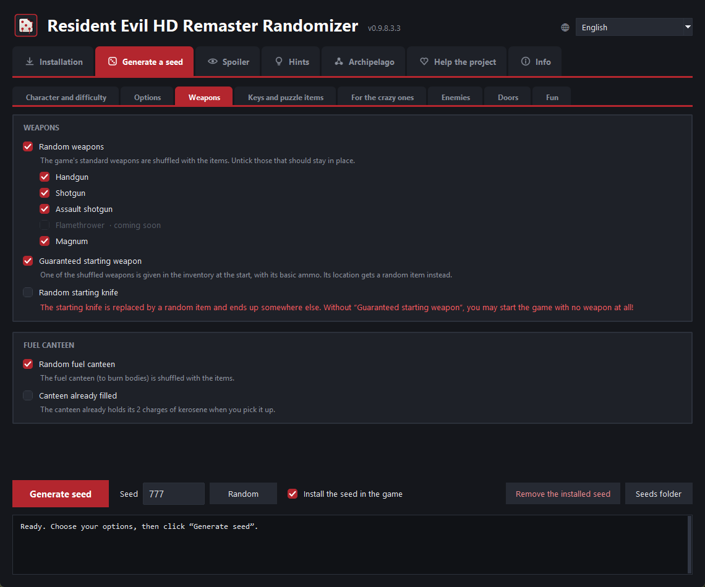
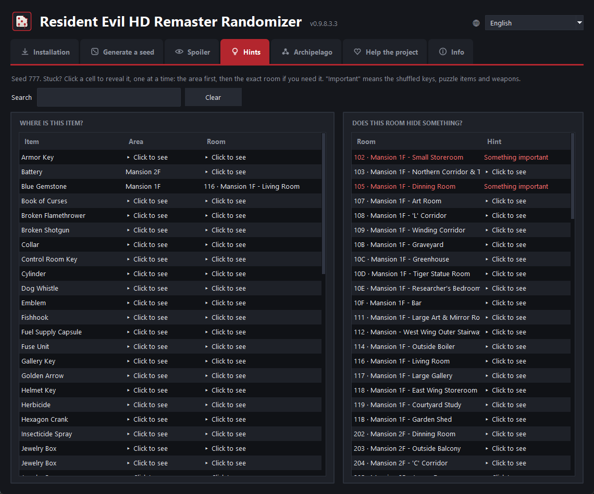

# Resident Evil HD Remaster Randomizer (PC / Steam)

[English](README.en.md) · [Français](README.fr.md) · **Deutsch** · [Español](README.es.md) · [Italiano](README.it.md) · [Português](README.pt.md) · [Русский](README.ru.md) · [日本語](README.ja.md) · [中文](README.zh.md)

> ⚠️ **Diese Übersetzung wurde noch nicht von einem Muttersprachler geprüft.** Die englische Fassung
> ([README.en.md](README.en.md)) ist die Referenz und kann aktueller sein. Fehler bitte in einem
> [Issue](https://github.com/Michiy0/Resident-Evil-HD-Remaster-Randomizer/issues) melden.

**[⬇ Neueste Version herunterladen](https://github.com/Michiy0/Resident-Evil-HD-Remaster-Randomizer/releases)** ·
[Problem melden](https://github.com/Michiy0/Resident-Evil-HD-Remaster-Randomizer/issues)

Der Randomizer **verteilt die Gegenstände des Spiels neu**: Munition, Kräuter, Farbbänder… liegen nicht mehr
dort, wo man sie erwartet, und jedes neue Spiel läuft anders ab. Der neue Gegenstand erscheint direkt am Boden
und in der Vorschau vor dem Aufheben.

Jede Mischung hat eine Nummer, den **Seed**. Derselbe Seed ergibt immer genau dieselbe Mischung: Teile die
Nummer, und ein Freund kann dasselbe Spiel spielen wie du, jeder auf seinem PC oder Steam Deck, um Zeiten
oder Strategien zu vergleichen.

> Inoffizielles **Fanprojekt**, nicht mit Capcom verbunden. Es sind keine Spieldateien enthalten: Du brauchst
> [Resident Evil HD Remaster auf Steam](https://store.steampowered.com/app/304240/).

## Kurz gesagt

- **Gegenstände wechseln den Platz**: Munition, Kräuter, Farbbänder, Dolche… und auf Wunsch auch **Schlüssel und
  Rätselgegenstände**, mit einer Logik, die das Spiel immer schaffbar hält.
- **Eine einfache App**: Randomizer installieren, Optionen wählen, Seed erstellen, fertig. Ein Klick bringt
  das Originalspiel zurück.
- **Sonst nichts zu installieren**: Eine kleine DLL wird mit dem Spiel geladen und erledigt die Arbeit. Der
  Code des Spiels wird nie verändert.
- **Windows und Steam Deck**: eine Windows-App und eine native Linux-App für das Steam Deck.
- **9 Sprachen**: Englisch, Französisch, Deutsch, Italienisch, Japanisch, Spanisch, Portugiesisch, Russisch
  und Chinesisch (standardmäßig die Systemsprache).
- **Gemeinschaftsprojekt**: Jeder Spieler kann mit dem eingebauten Erfassungsmodus helfen, die Gegenstände
  des Spiels zu erfassen.
- **Archipelago-Unterstützung in Vorbereitung**: siehe [Archipelago](#archipelago-demnächst).

## Bilder

<p align="center"><br><sub>Derselbe Raum, erst Originalspiel, dann Randomizer: Der Dolch auf dem Tisch ist jetzt ein grünes Kraut, und das Gewehr an der Wand wurde durch ein Pistolenmagazin ersetzt — sofort sichtbar, ohne etwas aufzuheben</sub></p>

<table>
<tr>
<td align="center"><br><sub>Seed erstellen: Schlüssel und Rätselgegenstände</sub></td>
<td align="center"><br><sub>Installation: die DLL mit einem Klick</sub></td>
</tr>
<tr>
<td align="center"><br><sub>Charakter und Schwierigkeit: welche Antwort im Spiel zu wählen ist</sub></td>
<td align="center"><br><sub>Spoiler: die vollständige Liste der Änderungen</sub></td>
</tr>
<tr>
<td align="center"><br><sub>Für Verrückte: nur das Ende garantiert, ohne Logik, Gewächshaus, Signalraketen</sub></td>
<td align="center"><br><sub>Waffen: zufällige Waffen, Startwaffe und Messer, Feldflasche</sub></td>
</tr>
<tr>
<td align="center" colspan="2"><br><sub>Hinweise: einer nach dem anderen</sub></td>
</tr>
</table>

## Stand

| Unterstützt | Demnächst |
|---|---|
| Chris, Schwierigkeit Leicht (ganzes Spiel erfasst, Labor inklusive) | Jill, weitere Schwierigkeitsgrade |
| 164 Fundorte: Munition (Pistole, Gewehr, Magnum), grüne, rote und blaue Kräuter, Farbbänder, Dolche, Blendgranaten, Selbstverteidigungswaffe, Erste-Hilfe-Sprays und -Kästen | — |
| Optionen **Zufällige Schlüssel** und **Zufällige Rätselgegenstände**, **mit Logik**: Das Spiel bleibt immer schaffbar (ein Schlüssel landet nie hinter der Tür, die er öffnet). Jeder Gegenstand lässt sich an- oder abwählen, die 3 MO-Disks einzeln. Villa, Hof, Wohnheim und Labor, Rätsel inklusive | Bienenpräparat und Köder ohne Haken (das Aquariumrätsel blockiert, wenn sie verschoben werden) |
| **Gegenstände am Boden sichtbar**: Der neue Gegenstand erscheint im Raum und in der Vorschau, auch fallengelassene oder enthüllte Gegenstände (Hundehalsband, Grabsymbole), untersuchte Gegenstände (Emblem am Kamin, Angelhaken) und in kurzen Szenen erhaltene; Option **Zufällige Kiste am Start** | — |
| Option **Zufällige Waffen** (Pistole, Gewehr, Kampfgewehr, Magnum) und **Garantierte Startwaffe** (zu Spielbeginn ins Inventar, mit Munition); Option **Zufälliges Startmesser** (du kannst ohne Waffe beginnen!); echte Bodenmodelle für Messer, Samurai Edge und Raketenwerfer mit unendlicher Munition | Weitere Waffen (Granatwerfer, Flammenwerfer), zufällige Gegner, zufällige Türen |
| **Feldflasche**: zufällige Feldflasche (immer auffindbar) und schon gefüllte Feldflasche (2 Ladungen) | — |
| Bereich **Spaß**: **Bonuswaffen** (Samurai Edge und Raketenwerfer mit unendlicher Munition) und **schon volle Treibstoffkapsel** (sie explodiert, wenn du rennst, getroffen wirst oder schießt!). **Für Verrückte**: wichtige Gegenstände im Gewächshaus, **Signalraketen überall**, **Nur das Ende garantiert** und **Ohne Logik** (reines Chaos) | — |
| Tab **Hinweise**: wo jeder wichtige Gegenstand ist (Bereich, dann genauer Raum) und ob ein Raum etwas verbirgt, jeder Hinweis bis zum Klick verborgen, mit Suchleiste | — |
| Windows und **Steam Deck** (im Spiel unter Proton getestet, auch SD-Karte); Linux | **[Archipelago](#archipelago-demnächst)** |

**Benötigte Spielversion**: die aktuelle Steam-`bhd.exe` (9.640.360 Bytes). Die App prüft das; bei jeder
anderen Version bleibt der Randomizer inaktiv und das Spiel unverändert.

## Was noch zu tun ist

Der Randomizer ist schon spielbar, aber vieles ist noch geplant, ungefähr in dieser Reihenfolge:

1. **Jill**: alle ihre Fundorte erfassen und die Schlüssellogik anpassen.
2. **Weitere Schwierigkeitsgrade**: die Gegenstände ändern sich mit dem Schwierigkeitsgrad.
3. **Die übrigen Waffen**: Granatwerfer und Flammenwerfer.
4. **Zufällige Gegner**.
5. **Zufällige Türen**: jede Tür führt in einen anderen Raum.
6. **Archipelago**: Multiworld mit anderen Spielen.

## Archipelago (demnächst)

[Archipelago](https://archipelago.gg) ist ein Multi-Game-Randomizer: Die Gegenstände deines Spiels können in
den Spielen anderer Spieler landen (und umgekehrt), jeder in seinem eigenen Spiel, gleichzeitig. Die
Unterstützung für Resident Evil HD Remaster ist in Vorbereitung: Der Tab *Archipelago* der App zeigt bereits
das (noch ausgegraute) Verbindungsformular und was noch zu tun ist. Die Schlüssel mit Logik sind seit v0.9.8
fertig.

## Fortschritt der Erfassung

Anteil der in einem **neuen Spiel** erfassten Räume, je Charakter und Schwierigkeit (siehe
[Projekt unterstützen](#projekt-unterstützen)). Details in der [englischen Fassung](README.en.md#survey-progress).


## Installation

### Windows

1. Lade `ResidentEvilHDRemasterRandomizer-v…-windows.zip` von den
   **[Releases](https://github.com/Michiy0/Resident-Evil-HD-Remaster-Randomizer/releases)** herunter und entpacke es irgendwo.
2. Starte `Resident Evil HD Remaster Randomizer.exe`. Der Spielordner wird automatisch gefunden (sonst: **Durchsuchen…**).
3. Tab **Installation**: Klicke einmal auf **DLL installieren**. Der Tab **Seed erstellen** wird freigeschaltet.
4. Wähle deine Optionen und klicke auf **Seed erstellen** (lass „Seed im Spiel installieren“ angehakt).
5. Starte das Spiel über Steam: **neues Spiel, Chris, Leicht**: Wähle bei der Frage nach deinem Spielstil die 2. Antwort, **„II. Gamer“** (das ist Leicht). Aus einem abgeschlossenen Spielstand: wähle **Leicht**. Bei einem anderen Schwierigkeitsgrad wird der Seed nicht angewendet.

Für einen anderen Seed: einen neuen erstellen und das Spiel neu starten. Die App **aktualisiert sich selbst**.

> **SmartScreen / Antivirus**: Die exe ist nicht signiert (Hobbyprojekt). Windows kann „Der Computer wurde
> durch Windows geschützt“ anzeigen → *Weitere Informationen* → *Trotzdem ausführen*. Manche Antivirenprogramme
> melden die DLL fälschlich: Sie nutzt einen Hardware-Haltepunkt (wie Cheat Engine). Der gesamte Quellcode
> ist in diesem Repository.

### Steam Deck / Linux

Die App gibt es als **native Linux-Version** (ohne Proton); das Spiel selbst läuft weiter mit Proton.

1. Lade im **Desktop-Modus** `ResidentEvilHDRemasterRandomizer-v…-linux.tar.gz` herunter und entpacke es.
2. Doppelklicke auf `Resident Evil HD Remaster Randomizer` (falls nötig: Rechtsklick → *Eigenschaften* →
   *Berechtigungen* → „Ausführbar“). Das Spiel wird in deiner Steam-Bibliothek gefunden, auch auf der SD-Karte.
3. Tab **Installation**: **DLL installieren**, dann die Startoption **Kopieren** und einmal in Steam einfügen
   (*Eigenschaften des Spiels → Startoptionen*):
   ```
   WINEDLLOVERRIDES="xinput1_4=n,b" %command%
   ```
   Wenn du **BhdTool** (oder einen anderen Mod in `dinput8.dll`) nutzt, hake *Auch dinput8.dll laden* an.
4. **Seed erstellen**, dann das Spiel starten.

Die App kann auch als **Nicht-Steam-Spiel** hinzugefügt werden, um sie im **Spielmodus** zu nutzen: Der Knopf
**Beenden** oben rechts schließt sie sauber.

**Zurück zum Originalspiel**: in der App **DLL deinstallieren** (auf dem Steam Deck auch die Startoption
entfernen).

## Benutzung

Die App hat sieben Tabs und oben rechts eine Sprachauswahl („Automatisch“ = Systemsprache).

- **Installation** — Spielordner, Status von Randomizer und installiertem Seed, DLL installieren /
  aktualisieren / deinstallieren (und die Startoption auf dem Steam Deck).
- **Seed erstellen** — mit acht Untertabs:
  - *Charakter und Schwierigkeit*;
  - *Optionen*: Gegenstände am Boden sichtbar, Zufällige Kiste am Start;
  - *Waffen*: Zufällige Waffen (mit Waffenliste), Garantierte Startwaffe, Zufälliges Startmesser; darunter die
    *Feldflasche* (zufällig, schon gefüllt);
  - *Schlüssel und Rätselgegenstände*: zufällige Schlüssel und Rätselgegenstände, jeweils mit Liste (*MO-Disk*
    klappt die 3 Disks auf, *Alter Schlüssel* die 5 alten Schlüssel);
  - *Für Verrückte*: nur das Ende garantiert; ohne Logik; wichtige Gegenstände im Gewächshaus; Signalraketen überall;
  - *Gegner*: Zufällige Gegner (demnächst);
  - *Türen*: Zufällige Türen, jede Tür führt in einen anderen Raum (demnächst);
  - *Spaß*: Bonuswaffen (Samurai Edge, Raketenwerfer oder beide) und schon volle Treibstoffkapsel;
  - **Seed erstellen** mit dem Seed (oder „Zufällig“) daneben — gleicher Seed + gleiche Optionen = gleiches
    Ergebnis.
- **Spoiler** — die vollständige Liste der Änderungen als Tabelle, mit Suche und Sortierung, verborgen, bis du
  *Spoiler anzeigen* anhakst.
- **Hinweise** — wo jeder wichtige Gegenstand ist und ob ein Raum etwas verbirgt; jedes Feld bleibt bis zum
  Klick verborgen, mit Suchleiste.
- **Archipelago** — demnächst.
- **Projekt unterstützen** — Erfassungsmodus und Fortschrittsbalken.
- **Info** — Mitwirkende und ein Link zu dieser Seite.

### Kompatibilität

- **BhdTool**: kompatibel (es nutzt `dinput8.dll`, der Randomizer `xinput1_4.dll`).
- **Ein anderer Mod, der eine `xinput1_4.dll` installiert**: nicht kompatibel. Die App erkennt ihn und rührt ihn nie an.

## Empfohlene Mods

### Resident Evil Fusion Fix

[Resident Evil Fusion Fix](https://github.com/ThirteenAG/WidescreenFixesPack/releases/tag/re1) (ThirteenAG)
macht das Spiel angenehmer: alle Auflösungen, randloses Fenster, Türanimationen überspringen, freie
Bildrate (optional)… Installation: `ResidentEvil.FusionFix.zip` in den Spielordner entpacken.

- Funktioniert zusammen mit dem Randomizer.
- Nutzt `dinput8.dll`, **wie BhdTool**: beide gleichzeitig geht nicht. Fusion Fix zum **Spielen**, BhdTool
  für die **Erfassung**.
- Auf dem Steam Deck auch *Auch dinput8.dll laden* anhaken.

## Projekt unterstützen

Der Randomizer mischt nur bereits **erfasste** Gegenstände. Jeder kann durch Spielen helfen:

1. Tab **Projekt unterstützen** → **Erfassungsmodus** anhaken (DLL installiert).
2. Ein **neues Spiel** starten.
3. Räume besuchen, ohne etwas aufzuheben; etwa 2 Sekunden in jedem bleiben.
4. Das Protokoll öffnen (Knopf **Spielprotokoll**) und an ein
   [Issue](https://github.com/Michiy0/Resident-Evil-HD-Remaster-Randomizer/issues) anhängen, mit Charakter und Schwierigkeit.

**Tipp: [BhdTool](https://github.com/eleval/BhdTool) spart viel Zeit** (Sprung in jeden Raum, Türen
überspringen; Menü mit **F5**).

## Problem melden

Öffne ein [Issue](https://github.com/Michiy0/Resident-Evil-HD-Remaster-Randomizer/issues) und hänge
`randomizer_journal.txt` an (Knopf **Spielprotokoll**), mit Seed, Optionen, Plattform und dem, was passiert ist.

## Für Entwickler

Siehe die [englische Fassung](README.en.md#for-developers) (Funktionsweise, Inhalt des Repositorys, Bauen).

## Mitwirkende

- **Autor**: **Jojo / Michiyo** (Delage Jordan) — [GitHub-Profil](https://github.com/Michiy0).
- **Tests und Erfassung der Gegenstände**: **Nico** (De Oliveira Gomes Nicolas) — „Number One Chris Fan“ 👊
- **Betatest**: **Nefer** (Quentin B)
- **[BhdTool](https://github.com/eleval/BhdTool)** (eleval, GPLv3): Raumnamen und -verbindungen, große Hilfe bei der Erfassung.
- Inspiriert von Community-Randomizern (BioRand, der frühere Randomizer von Benn Powell).

## Lizenz

GPLv3 — siehe [LICENSE](../LICENSE).
