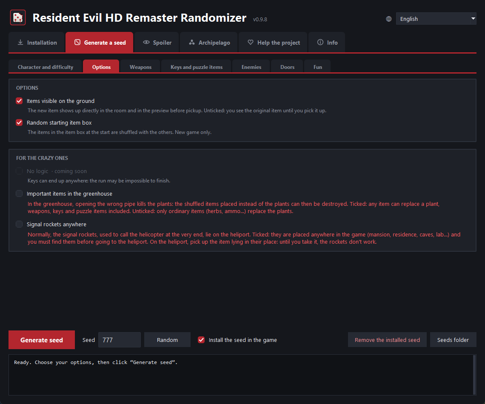
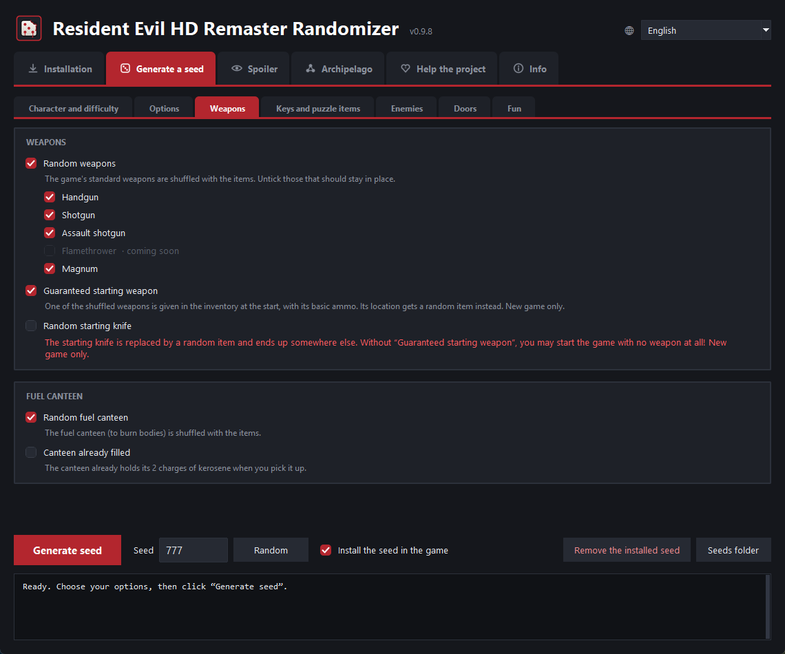
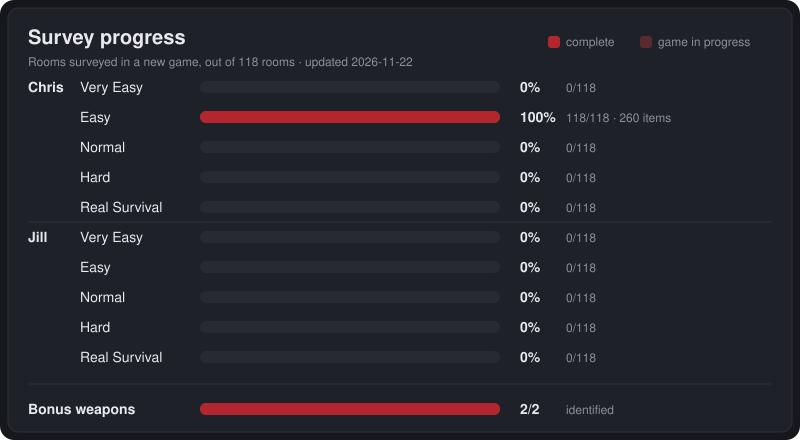

# Resident Evil HD Remaster Randomizer (PC / Steam)

[English](README.en.md) · [Français](README.fr.md) · [Deutsch](README.de.md) · **Español** · [Italiano](README.it.md) · [Português](README.pt.md) · [Русский](README.ru.md) · [日本語](README.ja.md) · [中文](README.zh.md)

> ⚠️ **Esta traducción todavía no ha sido revisada por un hablante nativo.** La versión en inglés
> ([README.en.md](README.en.md)) es la referencia y puede estar más actualizada. Si ves un error, avísanos en un
> [issue](https://github.com/Michiy0/Resident-Evil-HD-Remaster-Randomizer/issues).

**[⬇ Descargar la última versión](https://github.com/Michiy0/Resident-Evil-HD-Remaster-Randomizer/releases)** ·
[Informar de un problema](https://github.com/Michiy0/Resident-Evil-HD-Remaster-Randomizer/issues)

El randomizer **cambia de sitio los objetos del juego**: munición, hierbas, cintas de tinta… ya no están donde
esperas, y cada partida nueva es diferente. El nuevo objeto aparece directamente en el suelo y en la vista
previa antes de recogerlo.

Cada mezcla tiene un número, la **seed**. La misma seed da siempre exactamente la misma mezcla: comparte el
número y un amigo podrá jugar la misma partida que tú, cada uno en su PC o Steam Deck, para comparar tiempos
o estrategias.

> **Proyecto de fans** no oficial, sin relación con Capcom. No incluye ningún archivo del juego: necesitas
> [Resident Evil HD Remaster en Steam](https://store.steampowered.com/app/304240/).

## En resumen

- **Los objetos cambian de sitio**: munición, hierbas, cintas, puñales… y, si quieres, también **las llaves y los
  objetos de puzle**, con una lógica que mantiene la partida siempre terminable.
- **Una aplicación sencilla**: instala el randomizer, elige tus opciones, genera una seed y listo. Un clic
  devuelve el juego original.
- **Nada más que instalar**: una pequeña DLL se carga con el juego y hace el trabajo. El código del juego
  nunca se modifica.
- **Windows y Steam Deck**: una aplicación para Windows y una aplicación Linux nativa para la Steam Deck.
- **9 idiomas**: inglés, francés, alemán, italiano, japonés, español, portugués, ruso y chino (por defecto,
  el idioma del sistema).
- **Proyecto comunitario**: cualquier jugador puede ayudar a registrar los objetos del juego con el modo
  registro integrado.
- **Soporte de Archipelago en preparación**: ver [Archipelago](#archipelago-próximamente).

## Capturas

<p align="center"><br><sub>La misma sala, juego original y luego randomizer: el puñal de la mesa ahora es una hierba verde, y la escopeta colgada de la pared se sustituye por un cargador de pistola — visible al momento, sin recoger nada</sub></p>

<table>
<tr>
<td align="center"><br><sub>Generar una semilla: llaves y objetos de puzle</sub></td>
<td align="center"><br><sub>Instalación: la DLL en un clic</sub></td>
</tr>
<tr>
<td align="center"><br><sub>Personaje y dificultad: qué respuesta elegir en el juego</sub></td>
<td align="center"><br><sub>Spoiler: la lista completa de cambios</sub></td>
</tr>
<tr>
<td align="center"><br><sub>Opciones: objetos visibles, baúl inicial y opciones para los locos</sub></td>
<td align="center"><br><sub>Armas: armas aleatorias, arma y cuchillo iniciales, cantimplora</sub></td>
</tr>
</table>

## Estado

| Disponible | Próximamente |
|---|---|
| Chris, dificultad Fácil (todo el juego registrado, laboratorio incluido) | Jill, otras dificultades |
| 164 ubicaciones: munición (pistola, escopeta y magnum), hierbas verdes, rojas y azules, cintas, puñales, granadas cegadoras, pistola de autodefensa, sprays y botiquines | — |
| Opciones **Llaves aleatorias** y **Objetos de puzle aleatorios**, **con lógica**: la partida siempre se puede terminar (una llave nunca acaba detrás de la puerta que abre). Cada objeto se puede marcar o desmarcar; los 3 discos MO uno a uno. Mansión, patio, residencia y laboratorio, puzles incluidos | Opción *Sin lógica*; el espécimen de abeja y el señuelo sin anzuelo (el puzle del acuario se bloquea si se mueven) |
| **Objetos visibles en el suelo**: el nuevo objeto aparece en la sala y en la vista previa, también los objetos que caen o aparecen durante la partida (collar del perro, emblemas de la tumba), los que se obtienen al examinar algo (emblema de la chimenea, anzuelo) y los que se toman en una breve escena; opción **Baúl inicial aleatorio** | Pistas por sala |
| Opción **Armas aleatorias** (pistola, escopeta, escopeta de asalto, magnum) y **Arma garantizada al inicio** (en el inventario al empezar, con su munición); opción **Cuchillo inicial aleatorio** (¡puedes empezar sin arma!); modelos reales en el suelo para el cuchillo, la Samurai Edge y el lanzacohetes ilimitados | Otras armas (lanzagranadas, lanzallamas), enemigos aleatorios, puertas aleatorias |
| **Cantimplora**: cantimplora aleatoria (siempre se encuentra) y cantimplora ya llena (2 cargas) | — |
| Sección **Diversión**: **armas extra** (Samurai Edge y lanzacohetes con munición ilimitada) y **cápsula de combustible ya llena** (¡explota si corres, te golpean o disparas!). **Para los locos**: objetos importantes en el invernadero, **bengalas en cualquier lugar** | — |
| Windows y **Steam Deck** (probado en el juego con Proton, también en tarjeta SD); Linux | **[Archipelago](#archipelago-próximamente)** |

**Versión del juego necesaria**: el `bhd.exe` actual de Steam (9.640.360 bytes). La aplicación lo comprueba;
con cualquier otra versión el randomizer queda inactivo y el juego no se toca.

## Lo que queda por hacer

El randomizer ya se puede jugar, pero aún hay mucho previsto, más o menos en este orden:

1. **Jill**: registrar todos sus lugares de objetos y adaptar la lógica de las llaves.
2. **Otras dificultades**: los objetos cambian según la dificultad.
3. **Las demás armas**: lanzagranadas y lanzallamas.
4. Opción **Sin lógica**: llaves mezcladas sin red de seguridad.
5. **Pistas por sala**.
6. **Enemigos aleatorios**.
7. **Puertas aleatorias**: cada puerta lleva a otra sala.
8. **Archipelago**: multimundo con otros juegos.

## Archipelago (próximamente)

[Archipelago](https://archipelago.gg) es un randomizer multijuego: los objetos de tu partida pueden acabar en
los juegos de otros jugadores (y al revés), cada uno en su propio juego, a la vez. El soporte de Resident Evil
HD Remaster está en preparación: la pestaña *Archipelago* de la aplicación ya muestra el formulario de
conexión (desactivado) y lo que falta por hacer. Las llaves con lógica están listas desde la v0.9.8.

## Progreso del registro

Porcentaje de salas registradas en una **partida nueva**, por personaje y dificultad (ver
[Ayudar al proyecto](#ayudar-al-proyecto)). Detalles en la [versión en inglés](README.en.md#survey-progress).



## Instalación

### Windows

1. Descarga `ResidentEvilHDRemasterRandomizer-v…-windows.zip` desde las
   **[Releases](https://github.com/Michiy0/Resident-Evil-HD-Remaster-Randomizer/releases)** y descomprímelo donde quieras.
2. Abre `Resident Evil HD Remaster Randomizer.exe`. La carpeta del juego se encuentra sola (si no: **Examinar…**).
3. Pestaña **Instalación**: haz clic en **Instalar la DLL** (una vez). Se desbloquea la pestaña **Generar una semilla**.
4. Elige tus opciones y haz clic en **Generar la seed** (deja marcada «Instalar la seed en el juego»).
5. Inicia el juego desde Steam: **partida nueva, Chris, Fácil**: en la pregunta sobre tu estilo de juego, elige la 2.ª respuesta, **«II. Gamer»** (es Fácil). Desde una partida terminada: elige **Fácil**. En otra dificultad, la semilla no se aplica.

Para cambiar de seed: genera una nueva y reinicia el juego. La aplicación **se actualiza sola**.

> **SmartScreen / antivirus**: el exe no está firmado (proyecto aficionado). Windows puede mostrar «Windows
> protegió su PC» → *Más información* → *Ejecutar de todas formas*. Algunos antivirus pueden marcar la DLL por
> error: usa un punto de interrupción por hardware (como Cheat Engine). Todo el código fuente está en este
> repositorio.

### Steam Deck / Linux

La aplicación tiene una **versión Linux nativa** (sin Proton); el juego sigue funcionando con Proton.

1. En **modo escritorio**, descarga `ResidentEvilHDRemasterRandomizer-v…-linux.tar.gz` y descomprímelo.
2. Haz doble clic en `Resident Evil HD Remaster Randomizer` (si hace falta: clic derecho → *Propiedades* →
   *Permisos* → «Es ejecutable»). El juego se encuentra en tu biblioteca de Steam, también en la tarjeta SD.
3. Pestaña **Instalación**: **Instalar la DLL**, luego **Copiar** la opción de lanzamiento y pegarla una vez en
   Steam (*Propiedades del juego → Opciones de lanzamiento*):
   ```
   WINEDLLOVERRIDES="xinput1_4=n,b" %command%
   ```
   Si usas **BhdTool** (u otro mod en `dinput8.dll`), marca *Cargar también dinput8.dll*.
4. **Generar la seed** e iniciar el juego.

La aplicación también puede añadirse a Steam como **juego ajeno a Steam** para usarla en el **modo juego**: el
botón **Salir**, arriba a la derecha, la cierra correctamente.

**Volver al juego original**: en la aplicación, **Desinstalar la DLL** (en Steam Deck, quita también la opción
de lanzamiento).

## Uso

La aplicación tiene seis pestañas y un selector de idioma arriba a la derecha («Automático» = idioma del sistema).

- **Instalación** — carpeta del juego, estado del randomizer y de la seed instalada, instalar / actualizar /
  desinstalar la DLL (y la opción de lanzamiento en Steam Deck).
- **Generar una semilla** — con siete subpestañas:
  - *Personaje y dificultad*;
  - *Opciones*: objetos visibles en el suelo, baúl inicial aleatorio; debajo, *Para los locos* (sin lógica,
    próximamente; objetos importantes en el invernadero; bengalas en cualquier lugar);
  - *Armas*: armas aleatorias (con la lista de armas), arma garantizada al inicio, cuchillo inicial aleatorio;
    debajo, la *Cantimplora* (aleatoria, ya llena);
  - *Llaves y objetos de puzle*: llaves y objetos de puzle aleatorios, cada uno con su lista (*Disco MO*
    despliega los 3 discos);
  - *Enemigos*: enemigos aleatorios (próximamente);
  - *Puertas*: puertas aleatorias, cada puerta lleva a otra sala (próximamente);
  - *Diversión*: armas extra (Samurai Edge, lanzacohetes o ambos) y cápsula de combustible ya llena;
  - **Generar la seed**, con la seed (o «Al azar») al lado — misma seed + mismas opciones = mismo resultado.
- **Spoiler** — la lista completa de cambios en una tabla, con búsqueda y orden, oculta hasta que marques
  *Mostrar el spoiler*.
- **Archipelago** — próximamente.
- **Ayudar al proyecto** — modo registro y barras de progreso.
- **Info** — los créditos y un enlace a esta página.

### Compatibilidad

- **BhdTool**: compatible (usa `dinput8.dll`, el randomizer usa `xinput1_4.dll`).
- **Otro mod que instale un `xinput1_4.dll`**: incompatible. La aplicación lo detecta y nunca lo toca.

## Mods recomendados

### Resident Evil Fusion Fix

[Resident Evil Fusion Fix](https://github.com/ThirteenAG/WidescreenFixesPack/releases/tag/re1) (ThirteenAG)
hace el juego más cómodo: todas las resoluciones, ventana sin bordes, saltar la animación de las puertas,
fotogramas desbloqueados (opcional)… Instalación: descomprime `ResidentEvil.FusionFix.zip` en la carpeta del juego.

- Funciona junto con el randomizer.
- Usa `dinput8.dll`, **como BhdTool**: no se pueden tener los dos a la vez. Fusion Fix para **jugar**,
  BhdTool para **registrar**.
- En Steam Deck, marca también *Cargar también dinput8.dll*.

## Ayudar al proyecto

El randomizer solo mezcla objetos ya **registrados**. Cualquiera puede ayudar jugando:

1. Pestaña **Ayudar al proyecto** → marca el **modo registro** (DLL instalada).
2. Empieza una **partida nueva**.
3. Visita salas sin recoger nada; quédate unos 2 segundos en cada una.
4. Abre el registro (botón **Registro del juego**) y adjúntalo a un
   [issue](https://github.com/Michiy0/Resident-Evil-HD-Remaster-Randomizer/issues), indicando personaje y dificultad.

**Consejo: [BhdTool](https://github.com/eleval/BhdTool) ahorra mucho tiempo** (saltar a cualquier sala,
saltar las puertas; menú con **F5**).

## Informar de un problema

Abre un [issue](https://github.com/Michiy0/Resident-Evil-HD-Remaster-Randomizer/issues) y adjunta
`randomizer_journal.txt` (botón **Registro del juego**), con la seed, las opciones, la plataforma y lo que pasó.

## Para desarrolladores

Ver la [versión en inglés](README.en.md#for-developers) (funcionamiento, contenido del repositorio, compilación).

## Créditos

- **Autor**: **Jojo / Michiyo** (Delage Jordan) — [perfil de GitHub](https://github.com/Michiy0).
- **Pruebas y registro de objetos**: **Nico** (De Oliveira Gomes Nicolas) — «Number One Chris Fan» 👊
- **Beta testing**: **Nefer** (Quentin B)
- **[BhdTool](https://github.com/eleval/BhdTool)** (eleval, GPLv3): nombres y conexiones de las salas, gran ayuda para los registros.
- Inspirado en randomizers de la comunidad (BioRand, el antiguo randomizer de Benn Powell).

## Licencia

GPLv3 — ver [LICENSE](../LICENSE).
