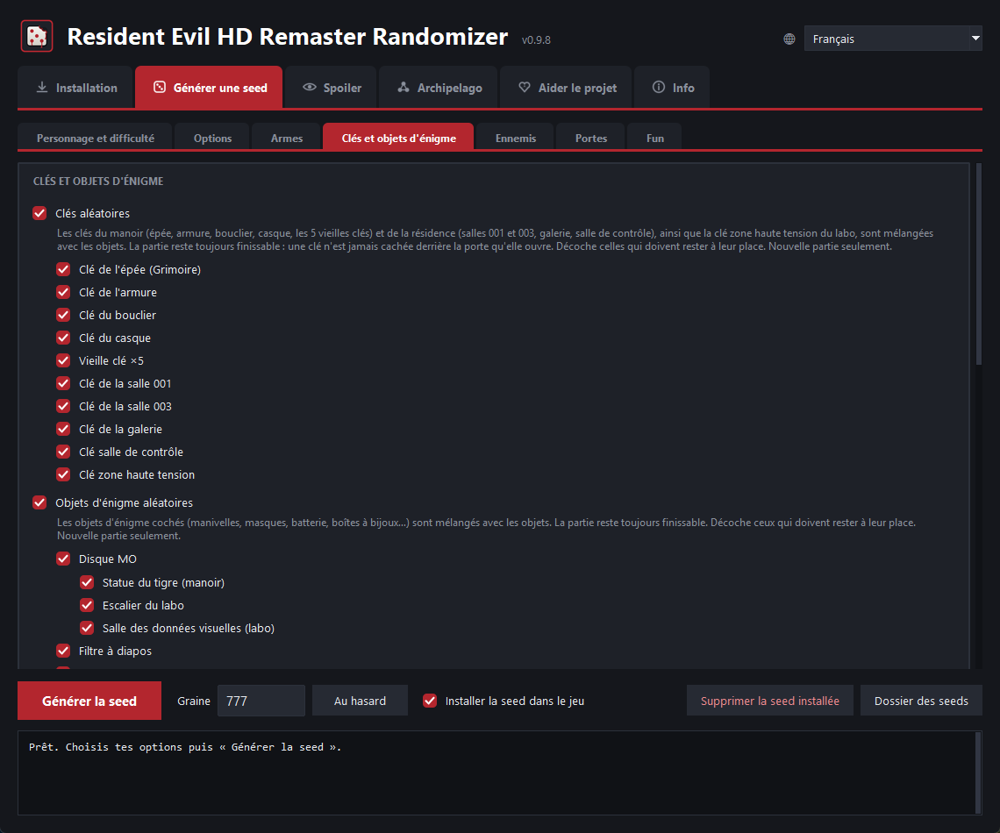
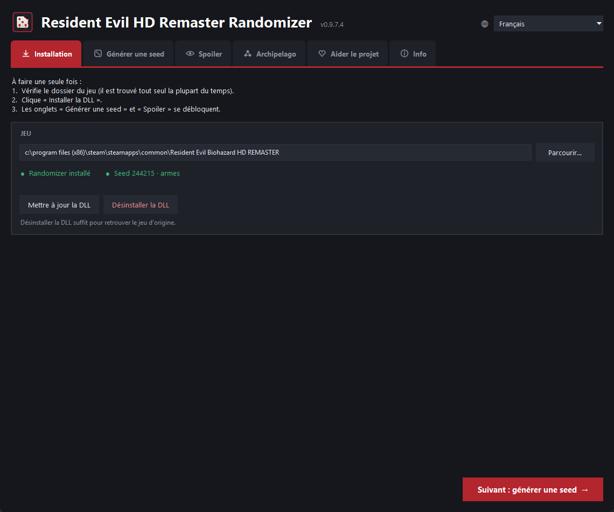
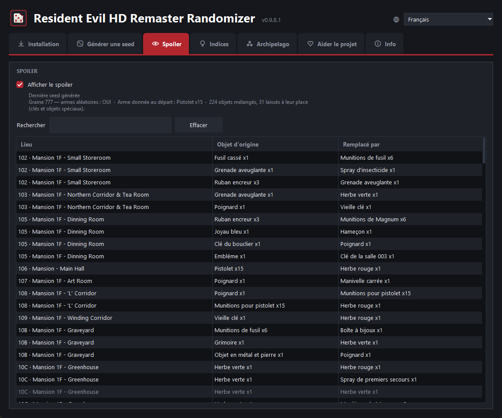
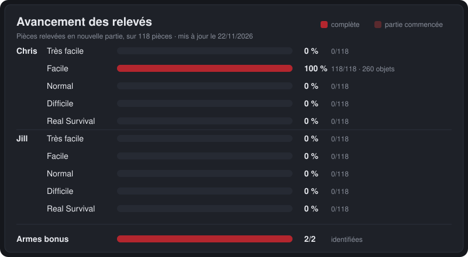

# Resident Evil HD Remaster Randomizer (PC / Steam)

🌐 [English](README.en.md) · **Français** · [Deutsch](README.de.md) · [Español](README.es.md) · [Italiano](README.it.md) · [Português](README.pt.md) · [Русский](README.ru.md) · [日本語](README.ja.md) · [中文](README.zh.md)

**[⬇ Télécharger la dernière version](https://github.com/Michiy0/Resident-Evil-HD-Remaster-Randomizer/releases)** ·
[Signaler un problème](https://github.com/Michiy0/Resident-Evil-HD-Remaster-Randomizer/issues)

Le randomizer **change la place des objets** du jeu : munitions, herbes, rubans encreurs… ne sont plus là
où tu les attends, et chaque nouvelle partie se joue différemment.

Chaque mélange porte un numéro, la **graine** (ou *seed*). La même graine donne toujours exactement le
même mélange : en partageant ce numéro, un ami peut jouer la même partie que toi, chacun de son côté
(sur son PC ou son Steam Deck), pour comparer vos temps ou vos stratégies.

> Projet de fan, **non officiel**, sans lien avec Capcom. Aucun fichier du jeu n'est inclus : il faut
> posséder [Resident Evil HD Remaster sur Steam](https://store.steampowered.com/app/304240/).

## En bref

- **Les objets changent de place** : munitions, herbes, rubans encreurs, poignards… Les clés et objets de
  quête restent à leur place, la partie reste toujours finissable.
- **On voit le nouvel objet** : il apparaît directement par terre dans le décor et dans l'aperçu avant
  ramassage (option « Objets visibles par terre »).
- **Une application simple** : on installe le randomizer, on choisit ses options, on génère une seed, et
  c'est prêt. Un clic suffit pour revenir au jeu d'origine.
- **Rien d'autre à installer** : une petite DLL se charge avec le jeu et fait le travail. Le code du jeu n'est
  jamais modifié.
- **Windows et Steam Deck** : application Windows, et application Linux native pour le Steam Deck.
- **9 langues** : français, anglais, allemand, italien, japonais, espagnol, portugais, russe et chinois (langue du système
  par défaut).
- **Projet communautaire** : chaque joueur peut aider à relever les objets du jeu, grâce à un mode relevé
  intégré.
- **Support d'Archipelago à venir** : le randomizer se prépare pour [Archipelago](https://archipelago.gg),
  le randomizer multi-jeux (voir [Archipelago](#archipelago-à-venir)).

## Aperçu

<p align="center"><br><sub>La même pièce, jeu d'origine puis randomizer : le poignard sur la table est devenu une herbe verte, et le fusil à pompe accroché au mur est remplacé par un chargeur de pistolet — visibles tout de suite, sans avoir à les ramasser</sub></p>

<table>
<tr>
<td align="center"><br><sub>Générer une seed : options et choix des armes</sub></td>
<td align="center"><br><sub>Installation : la DLL en un clic</sub></td>
</tr>
<tr>
<td align="center" colspan="2"><br><sub>Spoiler : la liste complète des changements</sub></td>
</tr>
</table>

## État : version 0.9.7 (test)

| Pris en charge | À venir |
|---|---|
| Chris, difficulté Facile (tout le jeu relevé, laboratoire compris) | Jill, autres difficultés |
| 164 emplacements d'objets posés : munitions (pistolet, fusil et Magnum), herbes vertes, rouges et bleues, rubans encreurs, poignards, grenades aveuglantes, pistolet d'autodéfense, sprays et trousses de premiers secours | Clés et objets de quête (avec une logique qui garantit que la partie reste finissable) |
| **Objets visibles par terre** : le nouvel objet s'affiche dans le décor et dans l'aperçu avant ramassage ; option **malle de départ aléatoire** | Objets de quête visibles et objets obtenus en examinant quelque chose (joyaux des trophées, hameçon… : déjà gérés par la DLL du jeu, nom et aperçu compris), avec les clés |
| Option **armes aléatoires**, avec le choix des armes à mélanger (pistolet, fusil, fusil d'assaut, Magnum) et option **arme garantie au départ** (donnée dans l'inventaire au début, avec ses munitions) ; option **couteau de départ aléatoire** (on peut commencer sans arme !) | Les autres armes (lance-grenades, lance-flammes), ennemis aléatoires |
| Section **Fun** : **armes bonus** (Samurai Edge et lance-roquettes illimités, chacun à la place d'un objet au hasard) | — |
| Windows et **Steam Deck** (testé en jeu sous Proton, carte SD comprise) ; Linux | Support d'**[Archipelago](#archipelago-à-venir)** |

**Version du jeu requise** : la version Steam actuelle de `bhd.exe` (9 640 360 octets, SHA-256
`39B840663E4B1A6835C60CBD176E4EE6C21B9197FC2C2DD733F2A7C36A0B429A`). L'application le vérifie ; sur une
autre version, le randomizer se met en veille et le jeu reste intact.

## Archipelago (à venir)

[Archipelago](https://archipelago.gg) est un randomizer multi-jeux : les objets de ta partie peuvent se
retrouver dans le jeu d'autres joueurs (et inversement), chacun sur son propre jeu, en même temps. Le support
de Resident Evil HD Remaster est en préparation.

- **Déjà dans l'application** : un onglet *Archipelago* avec le formulaire de connexion (serveur, nom du
  joueur, mot de passe, DeathLink), grisé pour l'instant, et la liste de ce qu'il reste à faire.
- **Reste à faire** : le mélange des clés et objets de quête avec la logique (en premier), l'envoi au serveur
  de chaque emplacement ramassé, la réception dans l'inventaire des objets des autres joueurs, le « monde »
  Archipelago du jeu (fichier `.apworld` : objets, emplacements, règles) et l'envoi de l'objectif (fin du jeu)
  au serveur.

Pas encore de date : le mélange des clés avec la logique doit être terminé avant.

## Avancement des relevés

Pourcentage de pièces relevées en **nouvelle partie** pour chaque personnage et difficulté
(voir [Aider le projet](#aider-le-projet)). Mis à jour à chaque version.

<!-- progression:debut -->



<details><summary>Détail (texte)</summary>

| Personnage | Difficulté | Pièces complètes | Visitées (partie commencée) | Objets relevés |
|---|---|---|---|---|
| Chris | Très facile | 0/118 (0 %) | 0 | 0 |
| Chris | Facile | 118/118 (100 %) | 0 | 260 |
| Chris | Normal | 0/118 (0 %) | 0 | 0 |
| Chris | Difficile | 0/118 (0 %) | 0 | 0 |
| Chris | Real Survival | 0/118 (0 %) | 0 | 0 |
| Jill | Très facile | 0/118 (0 %) | 0 | 0 |
| Jill | Facile | 0/118 (0 %) | 0 | 0 |
| Jill | Normal | 0/118 (0 %) | 0 | 0 |
| Jill | Difficile | 0/118 (0 %) | 0 | 0 |
| Jill | Real Survival | 0/118 (0 %) | 0 | 0 |

Armes bonus : 2/2 identifiées. Mis à jour le 22/11/2026.

</details>

<!-- progression:fin -->

## Installation

### Windows

1. Télécharge `ResidentEvilHDRemasterRandomizer-v…-windows.zip` dans les **[Releases](https://github.com/Michiy0/Resident-Evil-HD-Remaster-Randomizer/releases)**
   et extrais-le où tu veux.
2. Lance `Resident Evil HD Remaster Randomizer.exe`. Le dossier du jeu est trouvé automatiquement (sinon : **Parcourir…**).
3. Onglet **Installation** : clique **Installer la DLL** (une seule fois). L'onglet **Générer une seed**
   se débloque.
4. Choisis tes options, puis **Générer la seed** (laisse cochée « Installer la seed dans le jeu »).
5. Lance le jeu depuis Steam : **nouvelle partie, Chris, Facile**. À la question « Quel est votre style de jeu ? », choisis la 2e réponse, **« II. Gamer »** (c'est le Facile). Depuis une sauvegarde de jeu terminé (« Une fois de plus »), choisis **Facile**. Dans une autre difficulté, la seed ne s'applique pas.

Pour changer de seed : en générer une nouvelle, puis relancer le jeu.

### Mises à jour

L'application se met à jour automatiquement depuis la **v0.7**.

> **SmartScreen / antivirus** : l'exe n'est pas signé (projet amateur). Windows peut afficher « Windows a
> protégé votre ordinateur » → *Informations complémentaires* → *Exécuter quand même*. Certains antivirus
> peuvent aussi signaler la DLL par erreur : elle utilise un point d'arrêt matériel (comme Cheat Engine)
> pour repérer l'objet ramassé. Tout le code source est dans ce dépôt.

### Steam Deck / Linux

L'application existe en version **Linux native** (pas besoin de Proton pour elle) ; le jeu, lui, tourne
toujours avec Proton.

1. En **mode Bureau**, télécharge `ResidentEvilHDRemasterRandomizer-v…-linux.tar.gz` et extrais-le.
2. Double-clique sur `Resident Evil HD Remaster Randomizer` (si besoin : clic droit → *Propriétés* → *Permissions* →
   « Est exécutable »). Le jeu est trouvé dans la bibliothèque Steam, carte SD comprise.
3. Onglet **Installation** : clique **Installer la DLL**, puis **Copier** l'option de lancement, et
   colle-la une fois dans Steam (*Propriétés du jeu → Options de lancement*) :
   ```
   WINEDLLOVERRIDES="xinput1_4=n,b" %command%
   ```
   Si tu utilises **BhdTool** (ou un autre mod en `dinput8.dll`), coche *Ajouter dinput8.dll* (cochée d'office
   s'il est détecté) : la ligne devient `WINEDLLOVERRIDES="xinput1_4=n,b;dinput8=n,b" %command%`.
4. **Générer la seed**, puis lance le jeu.

L'application peut aussi être ajoutée à Steam comme **jeu non-Steam** pour l'utiliser en **mode Jeu** : le bouton **Quitter**, en haut à droite, la ferme proprement.

> **Testé et confirmé sur Steam Deck** : la DLL fonctionne dans le jeu sous Proton (jeu installé sur la
> carte SD). En cas de souci, le bouton **Journal du jeu** montre ce qui s'est passé.

### Revenir au jeu d'origine

Dans l'application : **Désinstaller la DLL** (sur Steam Deck, retire aussi l'option de lancement).
« Supprimer la seed installée » retire seulement la seed : sans seed, la DLL ne change rien au jeu.

## Utilisation

L'application a six onglets, et un sélecteur de langue en haut à droite (« Automatique » = langue du
système, anglais sinon).

- **Installation** — dossier du jeu, état du randomizer et de la seed installée, installer / mettre à
  jour / désinstaller la DLL (et l'option de lancement sur Steam Deck). L'application s'ouvre ici tant
  que la DLL n'est pas installée et à jour.
- **Générer une seed** — débloqué une fois la DLL en place, avec quatre sous-onglets :
  - *Personnage et difficulté* ;
  - *Options* : objets visibles par terre (cochée d'office ; décochée, on voit l'objet d'origine jusqu'au
    ramassage), malle de départ aléatoire (cochée d'office ; nouvelle partie seulement), armes aléatoires (cocher la case affiche la liste des armes ; décoche celles qui doivent
    rester à leur place), arme garantie au départ (donnée dans l'inventaire, avec ses munitions ; son emplacement
    reçoit un objet au hasard) et couteau de départ aléatoire (le couteau se retrouve ailleurs : sans arme garantie,
    on peut commencer sans arme) ; en dessous, dans sa propre carte, *Pour les fous* (sans logique, à venir) ;
  - *Ennemis* : ennemis aléatoires (à venir) ;
  - *Fun* : armes bonus (au choix le Samurai Edge, le lance-roquettes ou les deux) ;
  - **Générer la seed**, avec la graine (ou « Au hasard ») juste à côté — même graine + mêmes options = même
    résultat : écrit la seed dans le dossier `seeds` et l'installe dans le jeu.
- **Spoiler** — débloqué dès qu'il y a une seed : la liste complète des changements en tableau (lieu, objet
  d'origine, objet qui le remplace), avec recherche et tri, cachée tant qu'on ne coche pas *Afficher le
  spoiler*.
- **Archipelago** — à venir : le formulaire de connexion (grisé) et ce qu'il reste à faire.
- **Aider le projet** — le mode relevé et les barres d'avancement (voir plus bas).
- **Info** — les crédits (auteur, testeurs, remerciements) et le lien vers cette page.

Les options marquées « à venir » (clés, ennemis, autres armes, Archipelago…) sont visibles mais grisées.

### Compatibilité

- **BhdTool** : compatible (il utilise `dinput8.dll`, le randomizer `xinput1_4.dll`).
- **Autre mod qui installe un `xinput1_4.dll`** : incompatible. L'application le détecte et n'y touche
  jamais.

## Mods recommandés

Des mods facultatifs qui rendent le jeu plus agréable avec le randomizer. Aucun n'est obligatoire.

### Resident Evil Fusion Fix

[Resident Evil Fusion Fix](https://github.com/ThirteenAG/WidescreenFixesPack/releases/tag/re1) (ThirteenAG)
améliore le confort de jeu : toutes les résolutions de l'écran, fenêtre sans bordure, saut des animations de
porte, images par seconde débloquées (option), filtre de bruit et correction des couleurs désactivables.
Installation : extraire l'archive `ResidentEvil.FusionFix.zip` dans le dossier du jeu (réglages dans
`scripts/ResidentEvil.FusionFix.ini`).

- Il fonctionne à côté du randomizer (ce ne sont pas les mêmes DLL).
- Il utilise `dinput8.dll`, **comme BhdTool** : on ne peut pas avoir les deux en même temps. Fusion Fix est
  donc conseillé pour **jouer** ; pour **les relevés**, BhdTool reste plus pratique (voir *Aider le projet*).
- Sur Steam Deck, coche *Ajouter dinput8.dll* sous l'option de lancement de l'application.

## Aider le projet

Le randomizer ne mélange que les objets déjà **relevés**. Tout le monde peut aider en jouant :

1. Onglet **Aider le projet** → coche **Mode relevé** (DLL installée).
2. Lance une **nouvelle partie** : les objets déjà ramassés n'existent plus en mémoire.
3. Visite les pièces sans rien ramasser ; reste environ 2 secondes dans chacune. La DLL note les objets
   présents dans le journal du jeu (petite saccade d'environ 0,3 s à l'entrée d'une pièce).
4. Ouvre le journal (bouton **Journal du jeu**) et joins-le à une
   [issue](https://github.com/Michiy0/Resident-Evil-HD-Remaster-Randomizer/issues), en précisant le personnage et la difficulté.

**Astuce : [BhdTool](https://github.com/eleval/BhdTool) fait gagner beaucoup de temps.** Cet outil d'eleval, fait pour l'entraînement
au speedrun, s'installe en copiant son `dinput8.dll` (et `rooms.json`) dans le dossier du jeu ; il est
compatible avec le randomizer. En jeu, **F5** ouvre son menu :
- son outil pour **aller directement dans n'importe quelle pièce** permet de faire le tour du manoir en
  quelques minutes, en mode relevé (reste toujours environ 2 secondes dans chaque pièce) ;
- le **saut des portes** (*Door Skip*) supprime les animations d'ouverture de porte.

Sur Steam Deck, coche aussi *Ajouter dinput8.dll* sous l'option de lancement de l'application.

Les traductions ont été faites pour le projet : si tu parles une des 9 langues et vois une erreur,
signale-la aussi (les textes sont dans `Randomizer/textes.py`).

## Signaler un problème

Ouvre une [issue](https://github.com/Michiy0/Resident-Evil-HD-Remaster-Randomizer/issues) en joignant `randomizer_journal.txt`
(bouton **Journal du jeu**), avec la graine, les options, ta plateforme (Windows ou Steam Deck) et ce qui
s'est passé.

---

## Pour les développeurs

### Comment ça marche

- **L'application** (`Randomizer/application.py`, Python + Tk) tire une seed à partir du tableur
  `donnees_randomizer_RE1.xlsx` (emplacements relevés en jeu) et l'écrit dans le dossier du jeu sous le
  nom `randomizer_seed.lua`. Toute la logique est dans `generateur_seed.py`, utilisable aussi en ligne de
  commande.
- **La DLL** (`DLL/randomizer.c`) se fait passer pour `xinput1_4.dll` et transmet toutes les fonctions
  manette à la vraie DLL de Windows. Elle pose un **point d'arrêt matériel** sur `bhd.exe+1512ED` (lecture
  de l'objet ramassé) et, si l'emplacement est dans la seed, remplace l'identifiant et la quantité. Un
  emplacement est reconnu par sa pièce et son **empreinte** : les 4 coins (x, z) de sa zone de ramassage,
  identiques sur tous les PC.
- **Le mode relevé** (`Releve=1` dans `randomizer.ini`) repère à l'entrée de chaque pièce les objets posés
  en mémoire grâce à leur signature (`00C233F4` / `00C2286C`), sans rien ramasser.
- `bhd.exe` est protégé par SteamStub (code chiffré sur le disque) : la DLL ne modifie jamais le code et
  se met en veille sur une autre version du jeu.

### Contenu du dépôt

```
donnees_randomizer_RE1.xlsx   données : pièces, objets, emplacements, pièces relevées, bonus
DLL/                          la DLL (randomizer.c, xinput1_4.def) et ses scripts de compilation
Randomizer/
  application.py              l'application (6 onglets, 9 langues)
  mise_a_jour.py              mise à jour automatique depuis les Releases GitHub
  noms_jeu.py                 noms officiels des objets, lus dans les textes du jeu installé
  generateur_seed.py          génération des seeds (aussi en ligne de commande)
  importer_journal.py         importe les journaux de relevés dans le tableur
  progression.py              barres d'avancement de ce README
  textes.py                   toutes les traductions
  construire_exe.bat / construire_linux.sh, creer_icone.py, icônes
docs/                         le README dans les autres langues et les lisez-moi des archives
preparer_publication.py       prépare le dépôt, le zip Windows et l'archive Linux
```

### Construire

- **Windows** — Python 3 (`pip install openpyxl pyinstaller`) et GCC 32 bits de MSYS2
  (`pacman -S mingw-w64-i686-gcc`) :
  ```bat
  DLL\compiler.bat
  Randomizer\construire_exe.bat
  ```
- **Linux** (ou WSL ; Ubuntu 22.04 conseillé pour rester compatible avec le Steam Deck) —
  `sudo apt install python3 python3-venv python3-tk gcc-mingw-w64-i686` :
  ```sh
  sh DLL/compiler.sh
  sh Randomizer/construire_linux.sh
  ```
- **Sans compiler** : `python Randomizer/application.py`, ou en ligne de commande
  `python Randomizer/generateur_seed.py 12345 --armes-aleatoires --installer`.
- **Importer des relevés** :
  `python Randomizer/importer_journal.py journal.txt --personnage Chris --difficulte Facile --nouvelle-partie --ecrire`
  (sans `--nouvelle-partie` si la partie était déjà commencée : les pièces comptent alors comme visitées).

## Crédits

- **Auteur** : **Jojo / Michiyo** (Delage Jordan) — [profil GitHub](https://github.com/Michiy0).
- **Tests et relevés des objets** : **Nico** (De Oliveira Gomes Nicolas) — « Number One Chris Fan » 👊
- **[BhdTool](https://github.com/eleval/BhdTool)** (eleval, GPLv3) : son `rooms.json` fournit les noms et liaisons des pièces, et
  l'outil aide beaucoup pour les relevés (voir [Aider le projet](#aider-le-projet)).
- Inspiré des randomizers de la communauté (BioRand, ancien randomizer de Benn Powell).

## Licence

GPLv3 — voir [LICENSE](../LICENSE).
