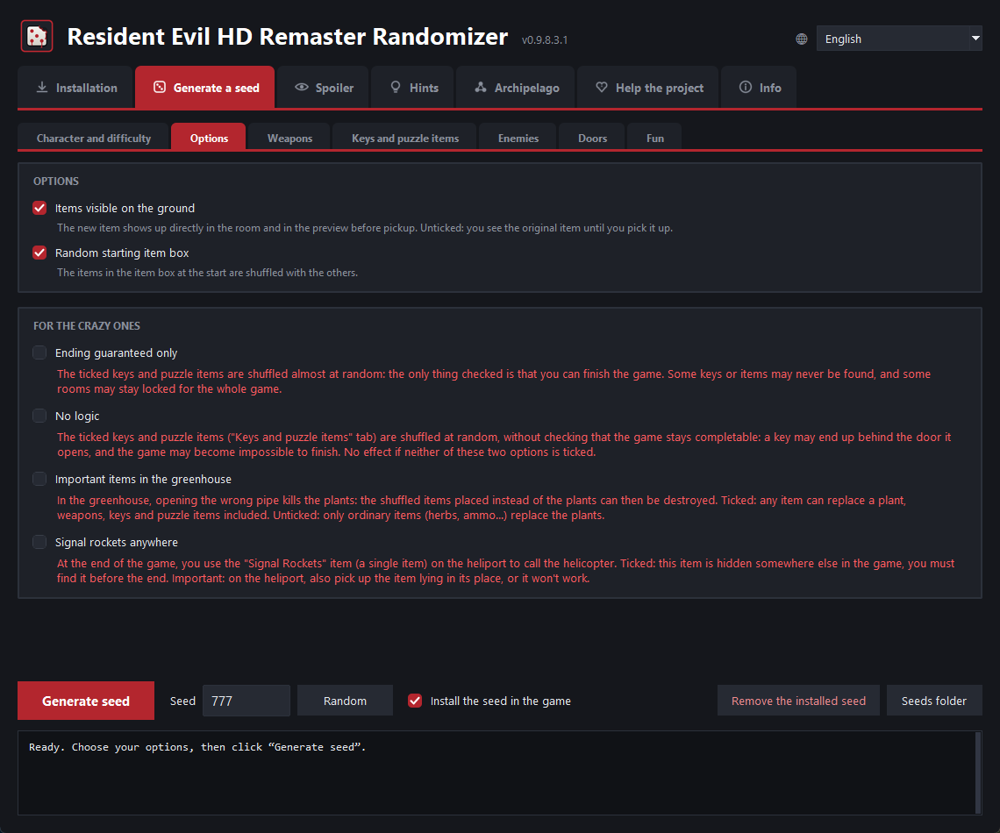
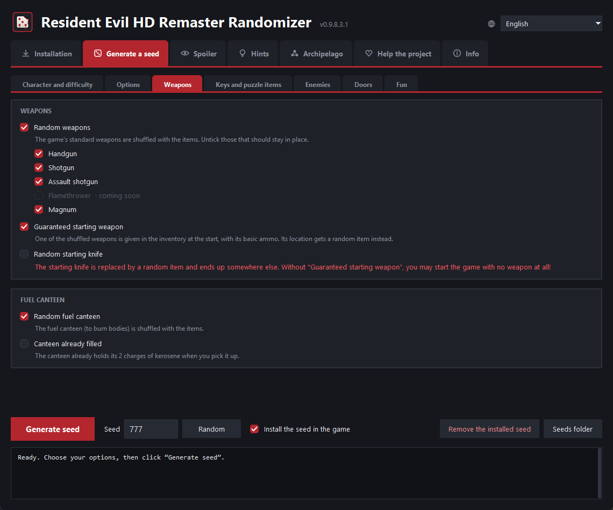
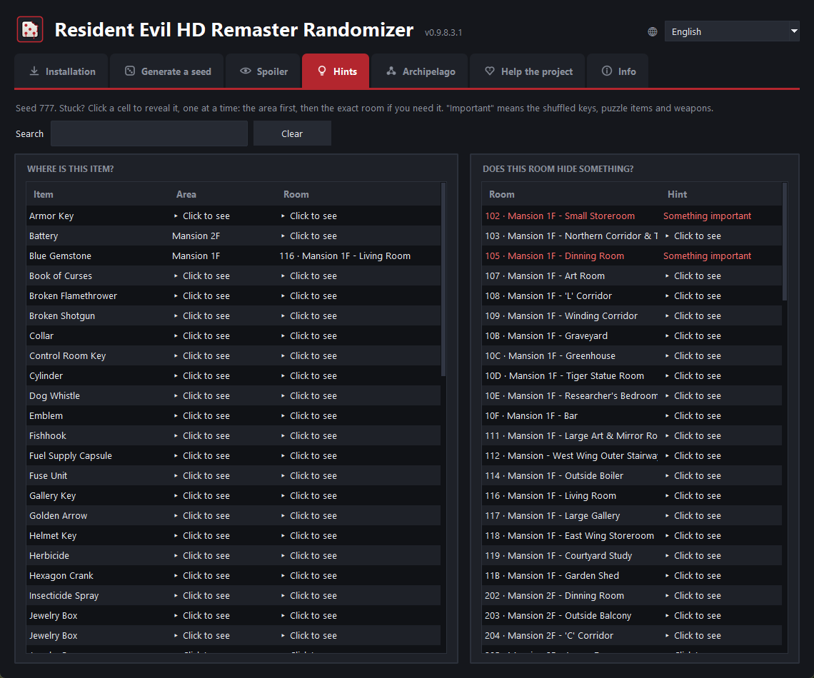

# Resident Evil HD Remaster Randomizer (PC / Steam)

[English](README.en.md) · [Français](README.fr.md) · [Deutsch](README.de.md) · [Español](README.es.md) · **Italiano** · [Português](README.pt.md) · [Русский](README.ru.md) · [日本語](README.ja.md) · [中文](README.zh.md)

> ⚠️ **Questa traduzione non è ancora stata verificata da un madrelingua.** La versione inglese
> ([README.en.md](README.en.md)) è il riferimento e può essere più aggiornata. Se trovi un errore, segnalalo in un
> [issue](https://github.com/Michiy0/Resident-Evil-HD-Remaster-Randomizer/issues).

**[⬇ Scarica l'ultima versione](https://github.com/Michiy0/Resident-Evil-HD-Remaster-Randomizer/releases)** ·
[Segnala un problema](https://github.com/Michiy0/Resident-Evil-HD-Remaster-Randomizer/issues)

Il randomizer **sposta gli oggetti del gioco**: munizioni, erbe, nastri inchiostratori… non sono più dove te
li aspetti, e ogni nuova partita è diversa. Il nuovo oggetto appare direttamente a terra e nell'anteprima
prima di raccoglierlo.

Ogni mescolata ha un numero, il **seed**. Lo stesso seed dà sempre esattamente la stessa mescolata: condividi
il numero e un amico potrà giocare la stessa partita, ognuno sul proprio PC o Steam Deck, per confrontare
tempi o strategie.

> **Progetto amatoriale** non ufficiale, non affiliato a Capcom. Nessun file del gioco è incluso: ti serve
> [Resident Evil HD Remaster su Steam](https://store.steampowered.com/app/304240/).

## In breve

- **Gli oggetti cambiano posto**: munizioni, erbe, nastri, pugnali… e, se vuoi, anche **le chiavi e gli oggetti
  degli enigmi**, con una logica che rende la partita sempre completabile.
- **Un'app semplice**: installa il randomizer, scegli le opzioni, genera un seed ed è fatta. Un clic riporta
  il gioco originale.
- **Nient'altro da installare**: una piccola DLL si carica con il gioco e fa il lavoro. Il codice del gioco non
  viene mai modificato.
- **Windows e Steam Deck**: un'app per Windows e un'app Linux nativa per Steam Deck.
- **9 lingue**: inglese, francese, tedesco, italiano, giapponese, spagnolo, portoghese, russo e cinese (per
  impostazione predefinita, la lingua del sistema).
- **Progetto della community**: ogni giocatore può aiutare a rilevare gli oggetti del gioco con la modalità
  rilevamento integrata.
- **Supporto ad Archipelago in preparazione**: vedi [Archipelago](#archipelago-in-arrivo).

## Immagini

<p align="center"><br><sub>La stessa stanza, gioco originale e poi randomizer: il pugnale sul tavolo ora è un'erba verde, e il fucile appeso al muro è sostituito da un caricatore della pistola — visibile subito, senza raccogliere nulla</sub></p>

<table>
<tr>
<td align="center"><br><sub>Genera un seed: chiavi e oggetti degli enigmi</sub></td>
<td align="center"><br><sub>Installazione: la DLL in un clic</sub></td>
</tr>
<tr>
<td align="center"><br><sub>Personaggio e difficoltà: quale risposta scegliere nel gioco</sub></td>
<td align="center"><br><sub>Spoiler: l'elenco completo delle modifiche</sub></td>
</tr>
<tr>
<td align="center"><br><sub>Opzioni: oggetti visibili, baule iniziale e opzioni per i pazzi</sub></td>
<td align="center"><br><sub>Armi: armi casuali, arma e coltello iniziali, borraccia</sub></td>
</tr>
<tr>
<td align="center" colspan="2"><br><sub>Indizi: uno alla volta</sub></td>
</tr>
</table>

## Stato

| Disponibile | In arrivo |
|---|---|
| Chris, difficoltà Facile (tutto il gioco rilevato, laboratorio compreso) | Jill, altre difficoltà |
| 164 posizioni: munizioni (pistola, fucile e magnum), erbe verdi, rosse e blu, nastri, pugnali, granate accecanti, pistola di autodifesa, spray e kit di pronto soccorso | — |
| Opzioni **Chiavi casuali** e **Oggetti degli enigmi casuali**, **con logica**: la partita resta sempre completabile (una chiave non finisce mai dietro la porta che apre). Ogni oggetto si può spuntare o togliere; i 3 dischi MO uno per uno. Villa, cortile, residenza e laboratorio, enigmi compresi | Il campione d'ape e l'esca senza amo (l'enigma dell'acquario si blocca se vengono spostati) |
| **Oggetti visibili a terra**: il nuovo oggetto appare nella stanza e nell'anteprima, anche gli oggetti lasciati cadere o rivelati durante la partita (collare del cane, stemmi della tomba), quelli ottenuti esaminando qualcosa (emblema del camino, amo) e quelli presi durante una breve scena; opzione **Baule iniziale casuale** | — |
| Opzione **Armi casuali** (pistola, fucile, fucile d'assalto, magnum) e **Arma garantita all'inizio** (nell'inventario all'avvio, con le munizioni); opzione **Coltello iniziale casuale** (puoi iniziare senza armi!); veri modelli a terra per il coltello, la Samurai Edge e il lanciarazzi illimitati | Altre armi (lanciagranate, lanciafiamme), nemici casuali, porte casuali |
| **Borraccia**: borraccia casuale (sempre trovabile) e borraccia già piena (2 cariche) | — |
| Sezione **Divertimento**: **armi bonus** (Samurai Edge e lanciarazzi con munizioni illimitate) e **capsula di carburante già piena** (esplode se corri, vieni colpito o spari!). **Per i pazzi**: oggetti importanti nella serra, **razzi di segnalazione ovunque**, **solo il finale garantito** e **senza logica** (caos puro) | — |
| Scheda **Indizi**: dove si trova ogni oggetto importante (zona, poi stanza esatta) e se ogni stanza nasconde qualcosa, ogni indizio nascosto fino al clic, con barra di ricerca | — |
| Windows e **Steam Deck** (testato in gioco con Proton, anche su scheda SD); Linux | **[Archipelago](#archipelago-in-arrivo)** |

**Versione del gioco richiesta**: il `bhd.exe` attuale di Steam (9.640.360 byte). L'app lo controlla; con
qualsiasi altra versione il randomizer resta inattivo e il gioco non viene toccato.

## Cosa resta da fare

Il randomizer è già giocabile, ma c'è ancora molto in programma, più o meno in quest'ordine:

1. **Jill**: registrare tutte le sue posizioni e adattare la logica delle chiavi.
2. **Altre difficoltà**: gli oggetti cambiano con la difficoltà.
3. **Le altre armi**: lanciagranate e lanciafiamme.
4. **Nemici casuali**.
5. **Porte casuali**: ogni porta porta in un'altra stanza.
6. **Archipelago**: multimondo con altri giochi.

## Archipelago (in arrivo)

[Archipelago](https://archipelago.gg) è un randomizer multi-gioco: gli oggetti della tua partita possono finire
nei giochi di altri giocatori (e viceversa), ognuno nel proprio gioco, contemporaneamente. Il supporto per
Resident Evil HD Remaster è in preparazione: la scheda *Archipelago* dell'app mostra già il modulo di
connessione (disattivato) e cosa resta da fare. Le chiavi con logica sono pronte dalla v0.9.8.

## Avanzamento dei rilevamenti

Percentuale di stanze rilevate in una **nuova partita**, per personaggio e difficoltà (vedi
[Aiuta il progetto](#aiuta-il-progetto)). Dettagli nella [versione inglese](README.en.md#survey-progress).


## Installazione

### Windows

1. Scarica `ResidentEvilHDRemasterRandomizer-v…-windows.zip` dalle
   **[Releases](https://github.com/Michiy0/Resident-Evil-HD-Remaster-Randomizer/releases)** ed estrailo dove vuoi.
2. Avvia `Resident Evil HD Remaster Randomizer.exe`. La cartella del gioco viene trovata da sola (altrimenti: **Sfoglia…**).
3. Scheda **Installazione**: clicca su **Installa la DLL** (una volta). Si sblocca la scheda **Genera un seed**.
4. Scegli le opzioni e clicca su **Genera il seed** (lascia spuntata «Installa il seed nel gioco»).
5. Avvia il gioco da Steam: **nuova partita, Chris, Facile**: alla domanda sul tuo stile di gioco scegli la 2ª risposta, **«II. Gamer»** (è Facile). Da un salvataggio di gioco finito: scegli **Facile**. In un'altra difficoltà il seed non viene applicato.

Per cambiare seed: generane uno nuovo e riavvia il gioco. L'app **si aggiorna da sola**.

> **SmartScreen / antivirus**: l'exe non è firmato (progetto amatoriale). Windows può mostrare «PC protetto da
> Windows» → *Ulteriori informazioni* → *Esegui comunque*. Alcuni antivirus possono segnalare la DLL per
> errore: usa un breakpoint hardware (come Cheat Engine). Tutto il codice sorgente è in questo repository.

### Steam Deck / Linux

L'app ha una **versione Linux nativa** (senza Proton); il gioco continua a girare con Proton.

1. In **modalità desktop**, scarica `ResidentEvilHDRemasterRandomizer-v…-linux.tar.gz` ed estrailo.
2. Fai doppio clic su `Resident Evil HD Remaster Randomizer` (se serve: clic destro → *Proprietà* →
   *Permessi* → «È eseguibile»). Il gioco viene trovato nella tua libreria Steam, anche su scheda SD.
3. Scheda **Installazione**: **Installa la DLL**, poi **Copia** l'opzione di avvio e incollala una volta in
   Steam (*Proprietà del gioco → Opzioni di avvio*):
   ```
   WINEDLLOVERRIDES="xinput1_4=n,b" %command%
   ```
   Se usi **BhdTool** (o un'altra mod in `dinput8.dll`), spunta *Carica anche dinput8.dll*.
4. **Genera il seed**, poi avvia il gioco.

L'app si può anche aggiungere a Steam come **gioco non Steam** per usarla in **modalità gioco**: il pulsante
**Esci**, in alto a destra, la chiude correttamente.

**Tornare al gioco originale**: nell'app, **Disinstalla la DLL** (su Steam Deck, togli anche l'opzione di avvio).

## Utilizzo

L'app ha sette schede e un selettore della lingua in alto a destra («Automatica» = lingua del sistema).

- **Installazione** — cartella del gioco, stato del randomizer e del seed installato, installare / aggiornare
  / disinstallare la DLL (e l'opzione di avvio su Steam Deck).
- **Genera un seed** — con sette sottoschede:
  - *Personaggio e difficoltà*;
  - *Opzioni*: oggetti visibili a terra, baule iniziale casuale; sotto, *Per i pazzi* (solo il finale garantito; senza logica;
    oggetti importanti nella serra; razzi di segnalazione ovunque);
  - *Armi*: armi casuali (con l'elenco delle armi), arma garantita all'inizio, coltello iniziale casuale; sotto, la
    *Borraccia* (casuale, già piena);
  - *Chiavi e oggetti degli enigmi*: chiavi e oggetti degli enigmi casuali, ognuno con il suo elenco (*Disco MO*
    apre i 3 dischi, *Vecchia chiave* le 5 vecchie chiavi);
  - *Nemici*: nemici casuali (in arrivo);
  - *Porte*: porte casuali, ogni porta porta a un'altra stanza (in arrivo);
  - *Divertimento*: armi bonus (Samurai Edge, lanciarazzi o entrambi) e capsula di carburante già piena;
  - **Genera il seed**, con il seed (o «Casuale») accanto — stesso seed + stesse opzioni = stesso risultato.
- **Spoiler** — l'elenco completo delle modifiche in una tabella, con ricerca e ordinamento, nascosto finché
  non spunti *Mostra lo spoiler*.
- **Indizi** — dove si trova ogni oggetto importante e se ogni stanza nasconde qualcosa; ogni casella resta
  nascosta fino al clic, con barra di ricerca.
- **Archipelago** — in arrivo.
- **Aiuta il progetto** — modalità rilevamento e barre di avanzamento.
- **Info** — i ringraziamenti e un link a questa pagina.

### Compatibilità

- **BhdTool**: compatibile (usa `dinput8.dll`, il randomizer usa `xinput1_4.dll`).
- **Un'altra mod che installa una `xinput1_4.dll`**: incompatibile. L'app la rileva e non la tocca mai.

## Mod consigliate

### Resident Evil Fusion Fix

[Resident Evil Fusion Fix](https://github.com/ThirteenAG/WidescreenFixesPack/releases/tag/re1) (ThirteenAG)
rende il gioco più comodo: tutte le risoluzioni, finestra senza bordi, salto dell'animazione delle porte,
frame rate sbloccato (opzionale)… Installazione: estrai `ResidentEvil.FusionFix.zip` nella cartella del gioco.

- Funziona insieme al randomizer.
- Usa `dinput8.dll`, **come BhdTool**: non si possono avere entrambi. Fusion Fix per **giocare**, BhdTool per
  i **rilevamenti**.
- Su Steam Deck, spunta anche *Carica anche dinput8.dll*.

## Aiuta il progetto

Il randomizer mescola solo gli oggetti già **rilevati**. Chiunque può aiutare giocando:

1. Scheda **Aiuta il progetto** → spunta la **modalità rilevamento** (DLL installata).
2. Inizia una **nuova partita**.
3. Visita le stanze senza raccogliere nulla; resta circa 2 secondi in ognuna.
4. Apri il registro (pulsante **Registro del gioco**) e allegalo a un
   [issue](https://github.com/Michiy0/Resident-Evil-HD-Remaster-Randomizer/issues), indicando personaggio e difficoltà.

**Consiglio: [BhdTool](https://github.com/eleval/BhdTool) fa risparmiare molto tempo** (salto in qualsiasi
stanza, salto delle porte; menu con **F5**).

## Segnalare un problema

Apri un [issue](https://github.com/Michiy0/Resident-Evil-HD-Remaster-Randomizer/issues) e allega
`randomizer_journal.txt` (pulsante **Registro del gioco**), con seed, opzioni, piattaforma e cosa è successo.

## Per gli sviluppatori

Vedi la [versione inglese](README.en.md#for-developers) (funzionamento, contenuto del repository, compilazione).

## Ringraziamenti

- **Autore**: **Jojo / Michiyo** (Delage Jordan) — [profilo GitHub](https://github.com/Michiy0).
- **Test e rilevamento degli oggetti**: **Nico** (De Oliveira Gomes Nicolas) — «Number One Chris Fan» 👊
- **Beta test**: **Nefer** (Quentin B)
- **[BhdTool](https://github.com/eleval/BhdTool)** (eleval, GPLv3): nomi e collegamenti delle stanze, un grande aiuto per i rilevamenti.
- Ispirato ai randomizer della community (BioRand, il precedente randomizer di Benn Powell).

## Licenza

GPLv3 — vedi [LICENSE](../LICENSE).
