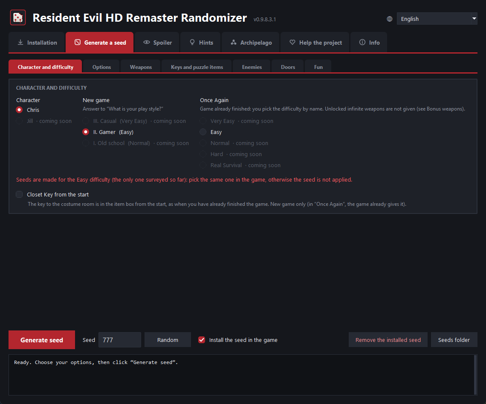

# Resident Evil HD Remaster Randomizer (PC / Steam)

[English](README.en.md) · [Français](README.fr.md) · [Deutsch](README.de.md) · [Español](README.es.md) · [Italiano](README.it.md) · [Português](README.pt.md) · [Русский](README.ru.md) · **日本語** · [中文](README.zh.md)

> ⚠️ **この翻訳はまだネイティブスピーカーによる確認を受けていません。** 英語版（[README.en.md](README.en.md)）が
> 正式な内容で、より新しい場合があります。誤りを見つけたら
> [issue](https://github.com/Michiy0/Resident-Evil-HD-Remaster-Randomizer/issues) でお知らせください。

**[⬇ 最新版をダウンロード](https://github.com/Michiy0/Resident-Evil-HD-Remaster-Randomizer/releases)** ·
[問題を報告](https://github.com/Michiy0/Resident-Evil-HD-Remaster-Randomizer/issues)

このランダマイザーは**ゲーム内のアイテムの配置を入れ替えます**。弾薬、ハーブ、インクリボンなどがいつもの場所に
なくなり、ニューゲームのたびに違う展開になります。新しいアイテムは床の上にも、拾う前のプレビューにも、そのまま
表示されます。

入れ替えの組み合わせには番号（**シード**）が付きます。同じシードからは必ず同じ組み合わせが生まれるので、番号を
共有すれば友だちと同じ内容を、それぞれの PC や Steam Deck で遊んで、タイムや攻略を比べられます。

> Capcom とは関係のない非公式の**ファンプロジェクト**です。ゲームのファイルは含まれていません。
> [Steam 版 Resident Evil HD Remaster（バイオハザード HD リマスター）](https://store.steampowered.com/app/304240/) が必要です。

## 概要

- **アイテムの場所が変わる**：弾薬、ハーブ、インクリボン、ダガーナイフなど。鍵やクエストアイテムは元の場所のまま
  なので、必ずクリアできます。
- **シンプルなアプリ**：ランダマイザーをインストールし、オプションを選び、シードを生成するだけ。ワンクリックで
  元のゲームに戻せます。
- **他に必要なものはなし**：小さな DLL がゲームと一緒に読み込まれて処理を行います。ゲームのコードは一切変更しません。
- **Windows と Steam Deck**：Windows 用アプリと、Steam Deck 用のネイティブ Linux アプリ。
- **9 言語**：英語、フランス語、ドイツ語、イタリア語、日本語、スペイン語、ポルトガル語、ロシア語、中国語
  （初期設定はシステムの言語）。
- **コミュニティプロジェクト**：内蔵の調査モードで、誰でもゲームのアイテム調査に協力できます。
- **Archipelago 対応を準備中**：[Archipelago](#archipelago近日対応) を参照。

## スクリーンショット

<p align="center"><br><sub>同じ部屋を元のゲーム、続いてランダマイザーで表示：テーブルのダガーナイフがグリーンハーブに、壁に掛かったショットガンがハンドガンのマガジンに変わっています。拾わなくてもすぐに分かります</sub></p>

<table>
<tr>
<td align="center"><br><sub>シード生成：オプションと武器の選択</sub></td>
<td align="center"><br><sub>インストール：DLL をワンクリックで</sub></td>
</tr>
<tr>
<td align="center"><br><sub>キャラクターと難易度：ゲーム内で選ぶ答え</sub></td>
<td align="center"><br><sub>ネタバレ：変更点の一覧</sub></td>
</tr>
</table>

## 対応状況

| 対応済み | 近日対応 |
|---|---|
| クリス、難易度イージー（研究所を含むゲーム全体を調査済み） | ジル、その他の難易度 |
| 164 か所：弾薬（ハンドガン、ショットガン、マグナム）、グリーン・レッド・ブルーハーブ、インクリボン、ダガーナイフ、閃光手榴弾、護身用拳銃、救急用スプレー、救急箱 | 鍵とクエストアイテム（必ずクリアできるロジック付き） |
| **床の上でも見える**：新しいアイテムが部屋とプレビューに表示されます。オプション **スタート時のアイテムボックスをランダム化** | 見えるクエストアイテムと、調べて手に入るアイテム（トロフィーの宝石、釣り針など：DLL は対応済み）。鍵と一緒に対応予定 |
| オプション **武器もランダム**（ハンドガン、ショットガン、アサルトショットガン、マグナム）と **序盤に武器を確保**（開始時に弾薬付きでインベントリに入ります）。オプション **初期装備のナイフをランダム化**（武器なしで始まることも！） | その他の武器（グレネードランチャー、火炎放射器）、敵のランダム化、ドアのランダム化 |
| **おたのしみ**：**ボーナス武器**（無限弾のサムライエッジとロケットランチャー） | — |
| Windows と **Steam Deck**（Proton 上でゲーム内テスト済み、SD カードも可）、Linux | **[Archipelago](#archipelago近日対応)** |

**必要なゲームのバージョン**：現在の Steam 版 `bhd.exe`（9,640,360 バイト）。アプリが確認します。他のバージョン
ではランダマイザーは動作せず、ゲームはそのままです。

## 今後の予定

ランダマイザーはすでに遊べますが、まだ多くの予定があります（おおよその順番）：

1. **ロジック付きの鍵ランダム化**：鍵やキーアイテムもシャッフルし、必ずクリアできるようにします。次の大きなステップです（*ロジックなし* と Archipelago にも必要）。
2. **ジル**：ジルのアイテム配置をすべて調査します。
3. **その他の難易度**：難易度によってアイテムが変わります。
4. **その他の武器**：グレネードランチャーと火炎放射器。
5. **敵のランダム化**。
6. **ドアのランダム化**：各ドアが別の部屋につながります。
7. **Archipelago**：他のゲームとのマルチワールド。

## Archipelago（近日対応）

[Archipelago](https://archipelago.gg) は複数のゲームをまたぐランダマイザーです。あなたのゲームのアイテムが他の
プレイヤーのゲームに入ったり、その逆も起こります（各自が自分のゲームを同時に遊びます）。Resident Evil HD
Remaster への対応を準備中です。アプリの *Archipelago* タブには、すでに接続フォーム（まだ使えません）と残りの作業が
表示されています。まずは鍵をロジック付きでランダム化する必要があります。

## 調査の進み具合

**ニューゲーム**で調査済みの部屋の割合（キャラクター・難易度別。[プロジェクトに協力](#プロジェクトに協力) を参照）。
詳細は[英語版](README.en.md#survey-progress)をご覧ください。


## インストール

### Windows

1. **[Releases](https://github.com/Michiy0/Resident-Evil-HD-Remaster-Randomizer/releases)** から
   `ResidentEvilHDRemasterRandomizer-v…-windows.zip` をダウンロードし、好きな場所に展開します。
2. `Resident Evil HD Remaster Randomizer.exe` を起動します。ゲームのフォルダーは自動で見つかります（見つからない
   場合：**参照…**）。
3. **インストール** タブ：**DLLをインストール** をクリック（1 回だけ）。**シード生成** タブが使えるようになります。
4. オプションを選び、**シードを生成** をクリック（「シードをゲームにインストール」はチェックしたまま）。
5. Steam からゲームを起動：**ニューゲーム、クリス、イージー**。プレイスタイルの質問では2番目の答え **「II」** を選んでください（これがイージーです）。クリアデータから始める場合は **イージー** を選んでください。別の難易度ではシードは適用されません。

シードを変えるには、新しいシードを生成してゲームを再起動します。アプリは**自動で更新されます**。

> **SmartScreen / ウイルス対策**：exe は署名されていません（個人プロジェクト）。Windows に「Windows によって PC が
> 保護されました」と表示されたら → *詳細情報* → *実行*。一部のウイルス対策ソフトが DLL を誤検出することがあります。
> これはハードウェアブレークポイント（Cheat Engine と同じ）を使うためです。ソースコードはすべてこのリポジトリにあります。

### Steam Deck / Linux

アプリには **ネイティブ Linux 版** があります（Proton 不要）。ゲーム自体は引き続き Proton で動作します。

1. **デスクトップモード** で `ResidentEvilHDRemasterRandomizer-v…-linux.tar.gz` をダウンロードして展開します。
2. `Resident Evil HD Remaster Randomizer` をダブルクリックします（必要なら：右クリック → *プロパティ* →
   *パーミッション* →「実行可能」）。ゲームは Steam ライブラリから見つかります（SD カードも可）。
3. **インストール** タブ：**DLLをインストール** の後、起動オプションを **コピー** し、Steam に一度だけ貼り付けます
   （*ゲームのプロパティ → 起動オプション*）：
   ```
   WINEDLLOVERRIDES="xinput1_4=n,b" %command%
   ```
   **BhdTool**（または `dinput8.dll` を使う他の MOD）を使う場合は、*dinput8.dll も読み込む* にチェックします。
4. **シードを生成** してからゲームを起動します。

アプリは **Steam 以外のゲーム** として Steam に追加して **ゲームモード** でも使えます。右上の **終了** ボタンで
きちんと閉じられます。

**元のゲームに戻す**：アプリで **DLLをアンインストール**（Steam Deck では起動オプションも削除）。

## 使い方

アプリには 6 つのタブと、右上の言語選択があります（「自動」＝システムの言語）。

- **インストール** — ゲームのフォルダー、ランダマイザーとインストール済みシードの状態、DLL のインストール / 更新 /
  アンインストール（Steam Deck では起動オプションも）。
- **シード生成** — 4 つのサブタブ：
  - *キャラクターと難易度*
  - *オプション*：床の上でも見える、スタート時のアイテムボックスをランダム化、武器もランダム（武器の一覧付き）、
    序盤に武器を確保（弾薬付きでインベントリへ。元の場所にはランダムなアイテム）、初期装備のナイフをランダム化。
    その下に *命知らず向け*（ロジックなし、近日対応）
  - *敵*：敵もランダム（近日対応）
  - *ドア*：ドアもランダム、各ドアが別の部屋につながります（近日対応）
  - *おたのしみ*：ボーナス武器（サムライエッジ、ロケットランチャー、または両方）
  - **シードを生成**（横にシード、または「ランダム」）— 同じシード＋同じオプション＝同じ結果
- **ネタバレ** — 変更点の一覧表（検索・並べ替え可）。*ネタバレを表示* にチェックするまで隠れています。
- **Archipelago** — 近日対応。
- **プロジェクトに協力** — 調査モードと進み具合のバー。
- **情報** — クレジットとこのページへのリンク。

### 互換性

- **BhdTool**：互換性あり（BhdTool は `dinput8.dll`、ランダマイザーは `xinput1_4.dll` を使用）。
- **`xinput1_4.dll` を入れる他の MOD**：互換性なし。アプリが検出し、決して触れません。

## おすすめの MOD

### Resident Evil Fusion Fix

[Resident Evil Fusion Fix](https://github.com/ThirteenAG/WidescreenFixesPack/releases/tag/re1)（ThirteenAG）で
ゲームがより快適になります：すべての解像度、ボーダーレスウィンドウ、ドア演出のスキップ、フレームレート制限解除
（任意）など。インストール：`ResidentEvil.FusionFix.zip` をゲームのフォルダーに展開します。

- ランダマイザーと一緒に使えます。
- **BhdTool と同じく** `dinput8.dll` を使うため、両方同時には使えません。**遊ぶ**なら Fusion Fix、**調査**なら BhdTool。
- Steam Deck では *dinput8.dll も読み込む* にもチェックします。

## プロジェクトに協力

ランダマイザーは**調査済み**のアイテムしか入れ替えません。誰でも遊びながら協力できます：

1. **プロジェクトに協力** タブ → **調査モード** にチェック（DLL インストール済み）。
2. **ニューゲーム** を始めます。
3. 何も拾わずに部屋を回り、各部屋で約 2 秒待ちます。
4. ログを開き（**ゲームのログ** ボタン）、キャラクターと難易度を書いて
   [issue](https://github.com/Michiy0/Resident-Evil-HD-Remaster-Randomizer/issues) に添付します。

**ヒント：[BhdTool](https://github.com/eleval/BhdTool) を使うと大幅に時間を節約できます**（好きな部屋へ移動、
ドア演出のスキップ。メニューは **F5**）。

## 問題の報告

[issue](https://github.com/Michiy0/Resident-Evil-HD-Remaster-Randomizer/issues) を作成し、`randomizer_journal.txt`
（**ゲームのログ** ボタン）を添付して、シード、オプション、プラットフォーム、起きたことを書いてください。

## 開発者向け

[英語版](README.en.md#for-developers) をご覧ください（仕組み、リポジトリの内容、ビルド方法）。

## クレジット

- **作者**：**Jojo / Michiyo**（Delage Jordan）— [GitHub プロフィール](https://github.com/Michiy0)
- **テストとアイテム調査**：**Nico**（De Oliveira Gomes Nicolas）— “Number One Chris Fan” 👊
- **[BhdTool](https://github.com/eleval/BhdTool)**（eleval、GPLv3）：部屋の名前とつながり、調査の大きな助け。
- コミュニティのランダマイザー（BioRand、Benn Powell 氏の以前のランダマイザー）から着想を得ています。

## ライセンス

GPLv3 — [LICENSE](../LICENSE) を参照。
