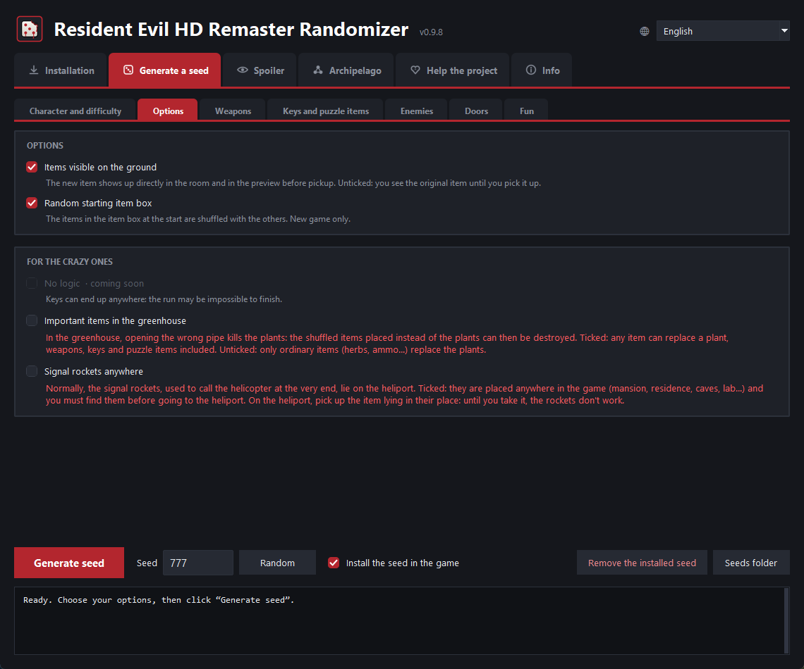
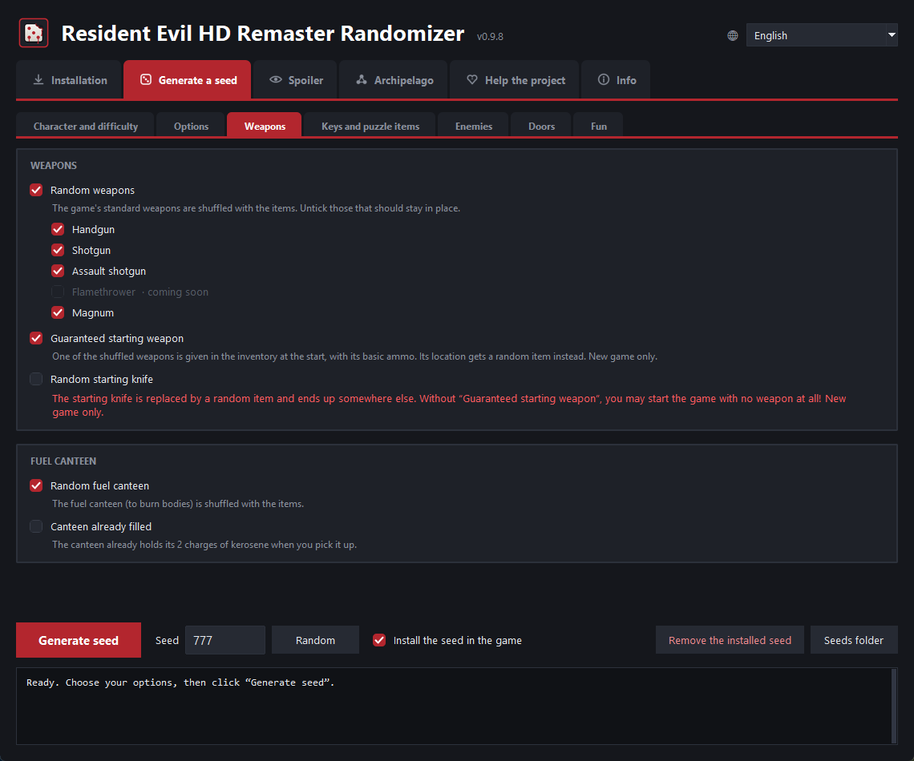

# Resident Evil HD Remaster Randomizer (PC / Steam)

[English](README.en.md) · [Français](README.fr.md) · [Deutsch](README.de.md) · [Español](README.es.md) · [Italiano](README.it.md) · **Português** · [Русский](README.ru.md) · [日本語](README.ja.md) · [中文](README.zh.md)

> ⚠️ **Esta tradução ainda não foi revisada por um falante nativo.** A versão em inglês
> ([README.en.md](README.en.md)) é a referência e pode estar mais atualizada. Se encontrar um erro, avise em um
> [issue](https://github.com/Michiy0/Resident-Evil-HD-Remaster-Randomizer/issues).

**[⬇ Baixar a versão mais recente](https://github.com/Michiy0/Resident-Evil-HD-Remaster-Randomizer/releases)** ·
[Relatar um problema](https://github.com/Michiy0/Resident-Evil-HD-Remaster-Randomizer/issues)

O randomizer **muda os itens do jogo de lugar**: munição, ervas, fitas de tinta… não estão mais onde você
espera, e cada novo jogo é diferente. O novo item aparece direto no chão e na prévia antes de pegar.

Cada mistura tem um número, a **seed**. A mesma seed dá sempre exatamente a mesma mistura: compartilhe o
número e um amigo pode jogar o mesmo jogo que você, cada um no seu PC ou Steam Deck, para comparar tempos ou
estratégias.

> **Projeto de fã** não oficial, sem ligação com a Capcom. Nenhum arquivo do jogo está incluído: você precisa
> de [Resident Evil HD Remaster na Steam](https://store.steampowered.com/app/304240/).

## Em resumo

- **Os itens mudam de lugar**: munição, ervas, fitas, adagas… e, se quiser, também **as chaves e os itens de
  enigma**, com uma lógica que mantém o jogo sempre terminável.
- **Um app simples**: instale o randomizer, escolha as opções, gere uma seed e pronto. Um clique traz de volta
  o jogo original.
- **Nada mais para instalar**: uma pequena DLL é carregada com o jogo e faz o trabalho. O código do jogo nunca
  é modificado.
- **Windows e Steam Deck**: um app para Windows e um app Linux nativo para o Steam Deck.
- **9 idiomas**: inglês, francês, alemão, italiano, japonês, espanhol, português, russo e chinês (por padrão,
  o idioma do sistema).
- **Projeto comunitário**: qualquer jogador pode ajudar a levantar os itens do jogo com o modo levantamento
  integrado.
- **Suporte ao Archipelago em preparação**: veja [Archipelago](#archipelago-em-breve).

## Imagens

<p align="center"><br><sub>A mesma sala, jogo original e depois randomizer: a adaga sobre a mesa agora é uma erva verde, e a espingarda pendurada na parede foi trocada por um carregador de pistola — visível na hora, sem pegar nada</sub></p>

<table>
<tr>
<td align="center"><br><sub>Gerar uma semente: chaves e itens de enigma</sub></td>
<td align="center"><br><sub>Instalação: a DLL em um clique</sub></td>
</tr>
<tr>
<td align="center"><br><sub>Personagem e dificuldade: qual resposta escolher no jogo</sub></td>
<td align="center"><br><sub>Spoiler: a lista completa de mudanças</sub></td>
</tr>
<tr>
<td align="center"><br><sub>Opções: itens visíveis, baú inicial e opções para os loucos</sub></td>
<td align="center"><br><sub>Armas: armas aleatórias, arma e faca iniciais, cantil</sub></td>
</tr>
</table>

## Situação

| Disponível | Em breve |
|---|---|
| Chris, dificuldade Fácil (jogo inteiro levantado, laboratório incluído) | Jill, outras dificuldades |
| 164 locais: munição (pistola, espingarda e magnum), ervas verdes, vermelhas e azuis, fitas, adagas, granadas de luz, pistola de autodefesa, sprays e kits de primeiros socorros | — |
| Opções **Chaves aleatórias** e **Itens de enigma aleatórios**, **com lógica**: o jogo sempre pode ser terminado (uma chave nunca fica atrás da porta que abre). Cada item pode ser marcado ou desmarcado; os 3 discos MO um por um. Mansão, pátio, residência e laboratório, enigmas incluídos | Opção *Sem lógica*; o espécime de abelha e a isca sem anzol (o enigma do aquário trava se forem movidos) |
| **Itens visíveis no chão**: o novo item aparece na sala e na prévia, inclusive itens largados ou revelados durante o jogo (coleira do cão, emblemas do túmulo), itens obtidos ao examinar algo (emblema da lareira, anzol) e itens pegos durante uma cena curta; opção **Baú inicial aleatório** | Dicas por sala |
| Opção **Armas aleatórias** (pistola, espingarda, espingarda de assalto, magnum) e **Arma garantida no início** (no inventário ao começar, com munição); opção **Faca inicial aleatória** (você pode começar sem arma!); modelos reais no chão para a faca, a Samurai Edge e o lança-foguetes ilimitados | Outras armas (lança-granadas, lança-chamas), inimigos aleatórios, portas aleatórias |
| **Cantil**: cantil aleatório (sempre encontrável) e cantil já cheio (2 cargas) | — |
| Seção **Diversão**: **armas bônus** (Samurai Edge e lança-foguetes com munição ilimitada) e **cápsula de combustível já cheia** (explode se você correr, for atingido ou atirar!). **Para os loucos**: itens importantes na estufa, **sinalizadores em qualquer lugar** | — |
| Windows e **Steam Deck** (testado no jogo com Proton, inclusive no cartão SD); Linux | **[Archipelago](#archipelago-em-breve)** |

**Versão do jogo necessária**: o `bhd.exe` atual da Steam (9.640.360 bytes). O app verifica isso; com qualquer
outra versão o randomizer fica inativo e o jogo não é alterado.

## O que ainda falta fazer

O randomizer já é jogável, mas ainda há muito planejado, mais ou menos nesta ordem:

1. **Jill**: registrar todos os seus locais de itens e adaptar a lógica das chaves.
2. **Outras dificuldades**: os itens mudam com a dificuldade.
3. **As outras armas**: lança-granadas e lança-chamas.
4. Opção **Sem lógica**: chaves misturadas sem rede de segurança.
5. **Dicas por sala**.
6. **Inimigos aleatórios**.
7. **Portas aleatórias**: cada porta leva a outra sala.
8. **Archipelago**: multimundo com outros jogos.

## Archipelago (em breve)

[Archipelago](https://archipelago.gg) é um randomizer multijogos: os itens do seu jogo podem ir parar nos jogos
de outros jogadores (e vice-versa), cada um no seu próprio jogo, ao mesmo tempo. O suporte a Resident Evil HD
Remaster está em preparação: a aba *Archipelago* do app já mostra o formulário de conexão (desativado) e o que
falta fazer. As chaves com lógica estão prontas desde a v0.9.8.

## Progresso do levantamento

Porcentagem de salas levantadas em um **novo jogo**, por personagem e dificuldade (veja
[Ajudar o projeto](#ajudar-o-projeto)). Detalhes na [versão em inglês](README.en.md#survey-progress).


## Instalação

### Windows

1. Baixe `ResidentEvilHDRemasterRandomizer-v…-windows.zip` nas
   **[Releases](https://github.com/Michiy0/Resident-Evil-HD-Remaster-Randomizer/releases)** e extraia onde quiser.
2. Abra `Resident Evil HD Remaster Randomizer.exe`. A pasta do jogo é encontrada sozinha (senão: **Procurar…**).
3. Aba **Instalação**: clique em **Instalar a DLL** (uma vez). A aba **Gerar uma semente** é liberada.
4. Escolha as opções e clique em **Gerar a seed** (deixe marcada “Instalar a seed no jogo”).
5. Inicie o jogo pela Steam: **novo jogo, Chris, Fácil**: na pergunta sobre o seu estilo de jogo, escolha a 2ª resposta, **“II. Gamer”** (é o Fácil). A partir de um save zerado: escolha **Fácil**. Em outra dificuldade, a seed não é aplicada.

Para trocar de seed: gere uma nova e reinicie o jogo. O app **se atualiza sozinho**.

> **SmartScreen / antivírus**: o exe não é assinado (projeto amador). O Windows pode mostrar “O Windows
> protegeu o computador” → *Mais informações* → *Executar assim mesmo*. Alguns antivírus podem acusar a DLL por
> engano: ela usa um ponto de interrupção de hardware (como o Cheat Engine). Todo o código-fonte está neste
> repositório.

### Steam Deck / Linux

O app tem uma **versão Linux nativa** (sem Proton); o jogo continua rodando com Proton.

1. No **modo área de trabalho**, baixe `ResidentEvilHDRemasterRandomizer-v…-linux.tar.gz` e extraia.
2. Clique duas vezes em `Resident Evil HD Remaster Randomizer` (se precisar: botão direito → *Propriedades* →
   *Permissões* → “É executável”). O jogo é encontrado na sua biblioteca Steam, inclusive no cartão SD.
3. Aba **Instalação**: **Instalar a DLL**, depois **Copiar** a opção de inicialização e colar uma vez na Steam
   (*Propriedades do jogo → Opções de inicialização*):
   ```
   WINEDLLOVERRIDES="xinput1_4=n,b" %command%
   ```
   Se você usa o **BhdTool** (ou outro mod em `dinput8.dll`), marque *Carregar também dinput8.dll*.
4. **Gerar a seed** e iniciar o jogo.

O app também pode ser adicionado à Steam como **jogo não Steam** para usá-lo no **modo jogo**: o botão **Sair**,
no canto superior direito, fecha o app corretamente.

**Voltar ao jogo original**: no app, **Desinstalar a DLL** (no Steam Deck, remova também a opção de inicialização).

## Uso

O app tem seis abas e um seletor de idioma no canto superior direito (“Automático” = idioma do sistema).

- **Instalação** — pasta do jogo, estado do randomizer e da seed instalada, instalar / atualizar /
  desinstalar a DLL (e a opção de inicialização no Steam Deck).
- **Gerar uma semente** — com sete subabas:
  - *Personagem e dificuldade*;
  - *Opções*: itens visíveis no chão, baú inicial aleatório; abaixo, *Para os loucos* (sem lógica, em breve;
    itens importantes na estufa; sinalizadores em qualquer lugar);
  - *Armas*: armas aleatórias (com a lista de armas), arma garantida no início, faca inicial aleatória; abaixo, o
    *Cantil* (aleatório, já cheio);
  - *Chaves e itens de enigma*: chaves e itens de enigma aleatórios, cada um com sua lista (*Disco MO* abre os
    3 discos);
  - *Inimigos*: inimigos aleatórios (em breve);
  - *Portas*: portas aleatórias, cada porta leva a outra sala (em breve);
  - *Diversão*: armas bônus (Samurai Edge, lança-foguetes ou os dois) e cápsula de combustível já cheia;
  - **Gerar a seed**, com a seed (ou “Aleatória”) ao lado — mesma seed + mesmas opções = mesmo resultado.
- **Spoiler** — a lista completa de mudanças em uma tabela, com busca e ordenação, escondida até você marcar
  *Mostrar o spoiler*.
- **Archipelago** — em breve.
- **Ajudar o projeto** — modo levantamento e barras de progresso.
- **Info** — os créditos e um link para esta página.

### Compatibilidade

- **BhdTool**: compatível (usa `dinput8.dll`, o randomizer usa `xinput1_4.dll`).
- **Outro mod que instala um `xinput1_4.dll`**: incompatível. O app detecta e nunca mexe nele.

## Mods recomendados

### Resident Evil Fusion Fix

[Resident Evil Fusion Fix](https://github.com/ThirteenAG/WidescreenFixesPack/releases/tag/re1) (ThirteenAG)
deixa o jogo mais confortável: todas as resoluções, janela sem bordas, pular a animação das portas, taxa de
quadros destravada (opcional)… Instalação: extraia `ResidentEvil.FusionFix.zip` na pasta do jogo.

- Funciona junto com o randomizer.
- Usa `dinput8.dll`, **como o BhdTool**: não dá para ter os dois ao mesmo tempo. Fusion Fix para **jogar**,
  BhdTool para os **levantamentos**.
- No Steam Deck, marque também *Carregar também dinput8.dll*.

## Ajudar o projeto

O randomizer só mistura itens já **levantados**. Qualquer um pode ajudar jogando:

1. Aba **Ajudar o projeto** → marque o **modo levantamento** (DLL instalada).
2. Comece um **novo jogo**.
3. Visite as salas sem pegar nada; fique cerca de 2 segundos em cada uma.
4. Abra o registro (botão **Registro do jogo**) e anexe a um
   [issue](https://github.com/Michiy0/Resident-Evil-HD-Remaster-Randomizer/issues), informando personagem e dificuldade.

**Dica: o [BhdTool](https://github.com/eleval/BhdTool) economiza muito tempo** (ir para qualquer sala, pular
as portas; menu com **F5**).

## Relatar um problema

Abra um [issue](https://github.com/Michiy0/Resident-Evil-HD-Remaster-Randomizer/issues) e anexe
`randomizer_journal.txt` (botão **Registro do jogo**), com a seed, as opções, a plataforma e o que aconteceu.

## Para desenvolvedores

Veja a [versão em inglês](README.en.md#for-developers) (funcionamento, conteúdo do repositório, compilação).

## Créditos

- **Autor**: **Jojo / Michiyo** (Delage Jordan) — [perfil no GitHub](https://github.com/Michiy0).
- **Testes e levantamento dos itens**: **Nico** (De Oliveira Gomes Nicolas) — “Number One Chris Fan” 👊
- **Beta teste**: **Nefer** (Quentin B)
- **[BhdTool](https://github.com/eleval/BhdTool)** (eleval, GPLv3): nomes e conexões das salas, uma grande ajuda nos levantamentos.
- Inspirado em randomizers da comunidade (BioRand, o antigo randomizer de Benn Powell).

## Licença

GPLv3 — veja [LICENSE](../LICENSE).
